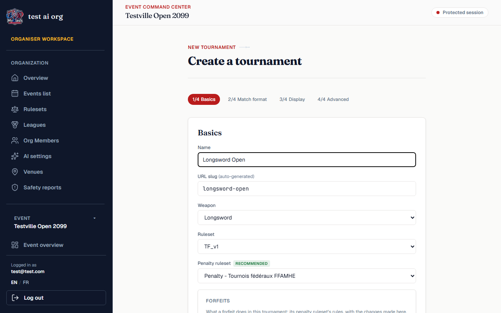
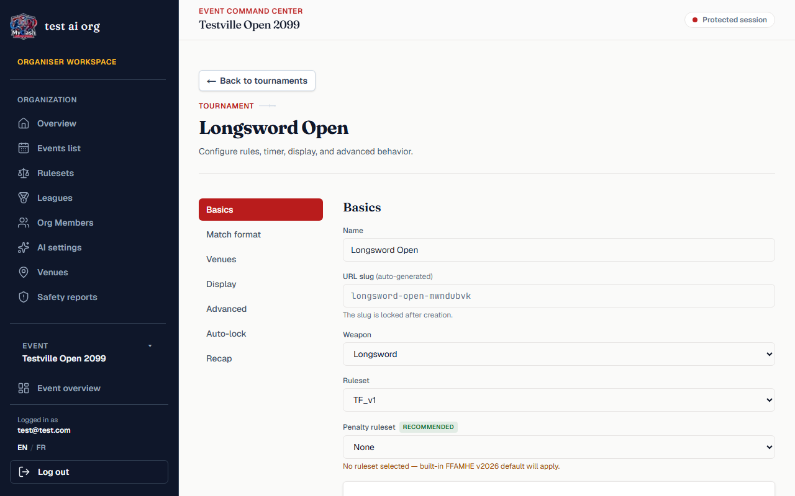

**What you'll do:** add a tournament to your event and choose its weapon, ruleset and match
format.

An event holds one or more tournaments: for example a longsword tournament and a sabre one.

## Create the tournament

On your event, open **Tournaments** and click **Create tournament**. The form has four steps:
**Basics**, **Match format**, **Display**, **Advanced**.

1. **Basics**
   - **Name**. The **URL slug** is generated from it, and the **Weapon** is guessed from it.
     Check both.
   - **Ruleset**: how a bout is scored. It starts on **TF_v1**.
   - **Penalty ruleset** (marked **Recommended**): the list of penalties the scoring pad offers.
     Left empty, the built-in FFAMHE 2026 list applies.
   - **Max participants** and **Max waitlist**, if you want a cap. A waitlist cap means nothing
     without a participant cap.
   - When you click **Next** here, the tournament is already saved as a draft.
2. **Match format**: the point cap, the timer, the bout length for pools, bracket and finals,
   double hits and afterblows.
3. **Display**: how the tournament looks on the public pages and screens.
4. **Advanced**: the tournament's pistes, and **Publish on finish** if you want it public right
   away. **Use defaults and finish** skips what you have not changed. Click **Finish**.

## Change the settings later

Every tournament has a **Settings** page with the same tabs, plus **Auto-lock** and **Recap**.
Change what you need and click **Save changes**.

<aside class="guide-warn">
  
<strong>Hard to undo.</strong> The tournament's URL slug is locked once it is created. And
  once a bout has started, the ruleset and the scoring rules can no longer be changed freely:
  only the organisation's owner can, with <strong>Re-pin ruleset</strong> and a public reason.
  Settle the rules before the first bout.

</aside>
