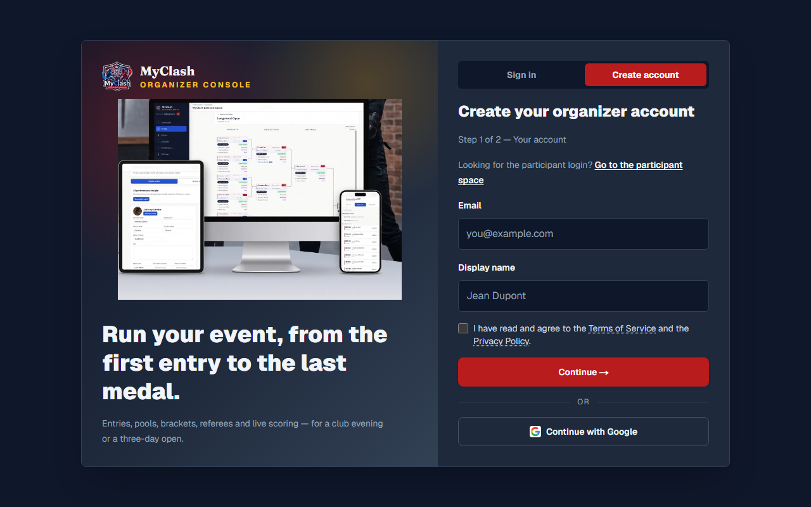
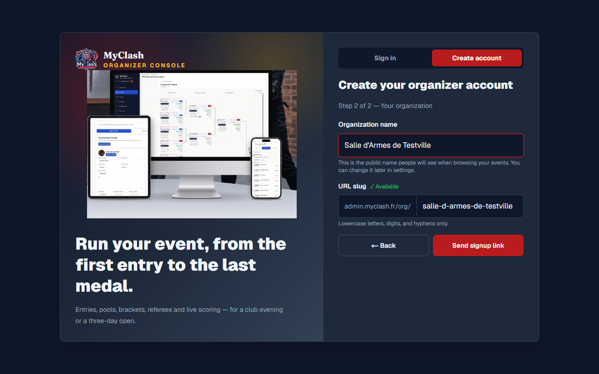
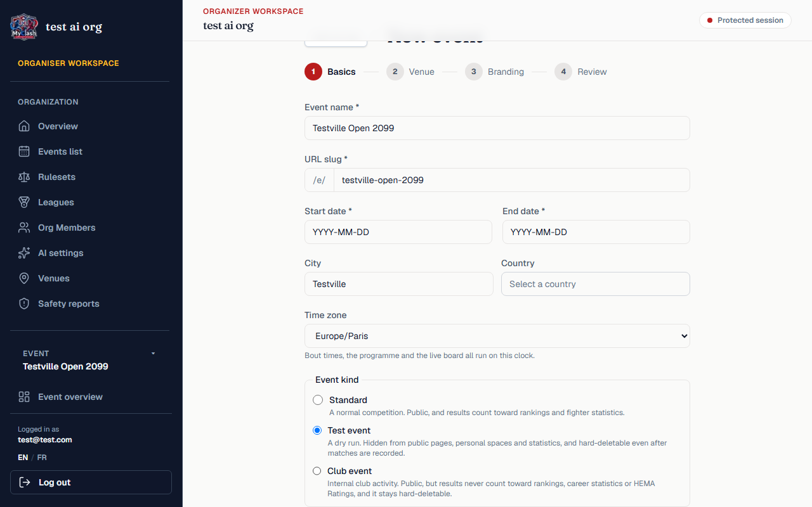

**What you'll do:** create your account and your organization, then choose the kind of your first
event.

## Create your account

1. Open [admin.myclash.fr/signup](https://admin.myclash.fr/signup).
2. **Step 1 of 2 — Your account**: enter your **Email** and your **Display name**, accept the
   terms, then click **Continue →**.

   

3. **Step 2 of 2 — Your organization**: enter the **Organization name** (the public name people
   will see, for example your club's). The **URL slug** fills itself in. It is your
   organization's web address: lowercase letters, digits and hyphens only. Wait for
   **✓ Available**.

   

4. Click **Send signup link**.
5. Open the email you receive and click the link. You choose your password, and your organization
   opens: you can create your first event straight away.

## Choose the kind of event

When you create an event, MyClash asks for its **Event kind**. That choice decides who sees the
event and whether its results count.

| Kind           | Can the public see it?           | Counts in rankings, career stats and leagues? | HEMA Ratings export | Your followers are told when you publish | Can be deleted even with results |
| -------------- | -------------------------------- | --------------------------------------------- | ------------------- | ---------------------------------------- | -------------------------------- |
| **Standard**   | Yes, once published              | Yes                                           | Yes                 | Yes                                      | No                               |
| **Test event** | Never (only your club's members) | No                                            | No                  | No                                       | Yes                              |
| **Club event** | Yes, once published              | No (only its own results pages)               | No                  | No                                       | Yes                              |

While an event is a **draft**, the public cannot see it, whatever its kind. Your club's members can
still open it.

## Which one should I choose?

- **You just want to try MyClash out:** create a **Test event**. Publish it, run pools, score
  fights, break things. Nobody outside your club sees it, it touches nobody's statistics, and you
  can delete it whenever you like.
- **You are running a real competition:** create a **new** event of kind **Standard**. Don't turn your test
  event into the real one: its practice fights and fighters would come along with it.
- **You are running a club night or a grading:** choose a **Club event**. It is public, so your
  members can follow it, but it changes nobody's ranking.

<aside class="guide-warn">
  
<strong>Hard to undo.</strong> A Standard event that has results can no longer be deleted.
  Try things out in a test event first.

</aside>
