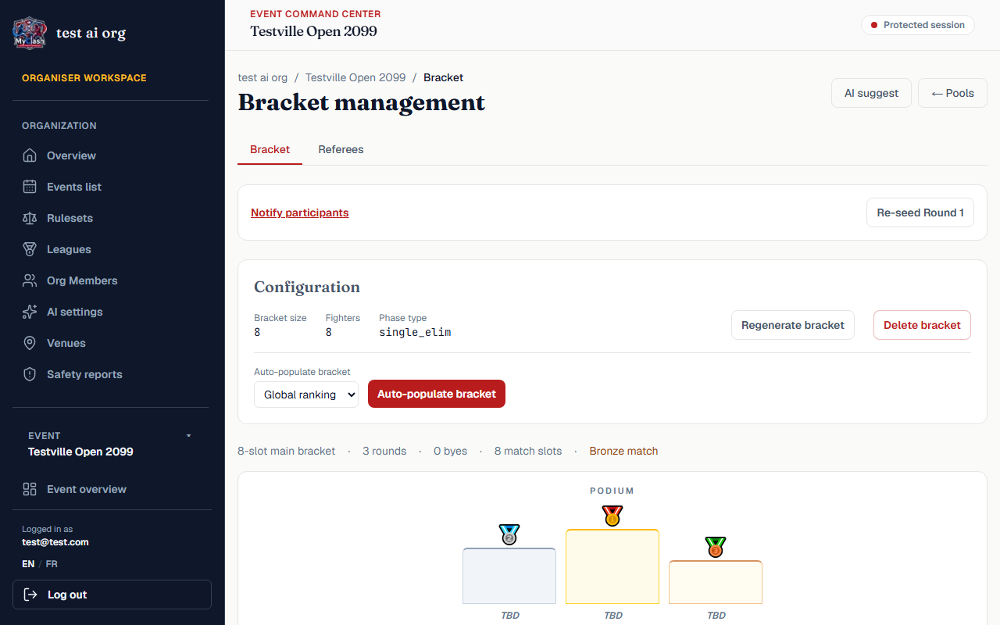

**What you'll do:** create the elimination bracket and fill it with the best fighters from the
pools.

## Generate the bracket

1. On your event, open **Bracket**. The page is called **Bracket management**.
2. Choose the **Format** (**Single elimination** or **Double elimination**) and how many fighters
   qualify from the pools.
3. Click **Generate bracket**.

## Fill it from the pools

When the pools are over, click **Auto-populate bracket**. Choose **Global ranking** (the best of
all pools) or **Top-N per pool** (the first N of each pool). MyClash places the fighters in the
first round from the pool standings, and names any tie at the cut-off.

The bouts of the bracket are then scored on the pad like the pool bouts. Each winner moves on to
the next round by themself.

If a pool result changes after the bracket was filled, a banner says so and proposes the fix.
**Re-seed Round 1** places the first round again, as long as none of its bouts has started.

<aside class="guide-warn">
  
<strong>Hard to undo.</strong> <strong>Regenerate bracket</strong> and
  <strong>Delete bracket</strong> delete every bout of the bracket, with its exchanges, cards and
  referee assignments. Once a bout has been fought, only the organisation's owner can still do
  it.

</aside>
