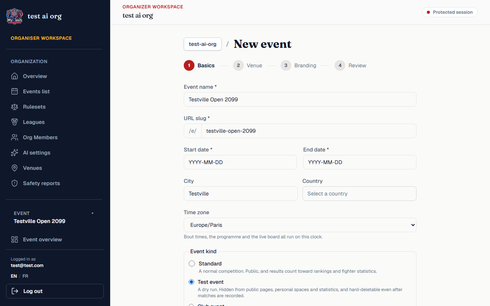

**What you'll do:** create the event: its name, dates, kind, venue and pistes.

## The four steps

In your organiser workspace, open **Events list** and click **Create event**. A four-step form
opens: **Basics**, **Venue**, **Branding**, **Review**. Click **Next** to go on, or **Back** to
change something.

1. **Basics**
   - **Event name**. The **URL slug** fills itself in from the name. It is the event's web
     address: lowercase letters, digits and hyphens only.
   - **Start date** and **End date**. If you move the start date past the end date, the end date
     follows.
   - **City**, **Country** and **Time zone**. The time zone matters: bout times, the schedule and
     the live board all run on it.
   - **Event kind**: **Standard**, **Test event** or **Club event**. See
     [Before you start](/en/guide/before-you-start) to choose.
2. **Venue**
   - **Pick existing venue** reuses a venue you saved before, with its pistes. The first time,
     use **Create new venue**: give it a **Venue name**, and tick what it hosts (**Tournament**,
     **Workshop**, or both).
   - A venue that hosts a tournament needs at least one piste. Add each one with **Add lice** (a
     "lice" is a piste) and give it a name. You can have up to 12.
3. **Branding**: your event's logo, as a link or an uploaded file (PNG, JPEG or WebP, up to
   10 MB). This is optional.
4. **Review**: check everything, then click **Create event**.

The event is created as a **draft**. Nobody outside your club sees it until you publish it.

## Pistes later

You can add pistes after the event exists. On the event's **Schedule** page, click
**+ Add lice**. Venues you save under **Venues** in the organisation menu pre-fill the pistes of
your next events.

<aside class="guide-warn">
  
<strong>Hard to undo.</strong> Once the event exists, its URL slug is locked. Pick it with
  care: it is the address you will share.

</aside>
