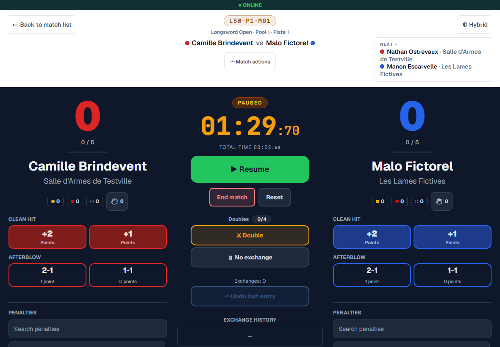
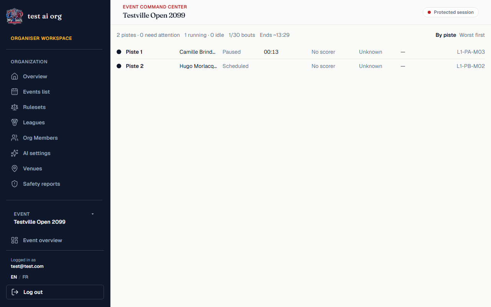

**What you'll do:** check that everything is ready, sign the tablets in, score the bouts, and
follow every piste from one screen.

## Before the first bout

On your event, open **Start of day**. It checks four things in order: the event exists, the
roster is trustworthy, the draw exists, and it can be run. Each line says **Clear** or how many
things are left to do, and links to the screen that fixes them.

## Sign the tablets in

On each tablet, open the sign-in link from **Event Staff** (or scan its QR code). Enter the
account's **Username** and **PIN**, then tap **Sign in with PIN**. The tablet lists the bouts of
the pistes this account is assigned to.

Before the event, try **Practice going offline** on the piste list: a two-minute drill that shows
the scorekeeper what the pad looks like without wifi.

## Score a bout

- **Start** runs the clock; **Pause** stops it; **Resume** starts it again. The exchange buttons work only while the clock is paused: the referee halts, you pause, enter the exchange, and resume.
- Each fighter has **Clean hit** buttons (+2, +1) and **Afterblow** buttons (2-1, 1-1), as the
  tournament's ruleset defines them.
- **Double** records a double hit, **No exchange** an exchange with no valid hit.
- **Undo last entry** takes back the last thing entered.
- **Penalties**: search the penalty list and give a card.
- **End match** when the bout is over. **Match actions** opens the corrections.

The score on the pad is calculated by MyClash from the exchanges entered, with the tournament's
ruleset.

## When the wifi drops

The bar at the top of the pad says **ONLINE** in green. When the network goes, it turns grey and
says that the exchanges are queued on the tablet. Keep scoring: hits, cards and clock presses
are kept on the tablet and sent as soon as the network comes back. Only the corrections (in
**Match actions**) need the network.

## Follow every piste

Open **Live**. One line per piste: who is fighting, the bout's state, whether the tablet is in
sync. **Worst first** puts the pistes that need you at the top. Click a piste to give it another
scorer.

<aside class="guide-warn">
  
<strong>Hard to undo.</strong> Re-opening an ended bout needs the network. With the wifi
  down, an ended bout stays ended until it comes back, so check the score before
  <strong>End match</strong>.

</aside>
