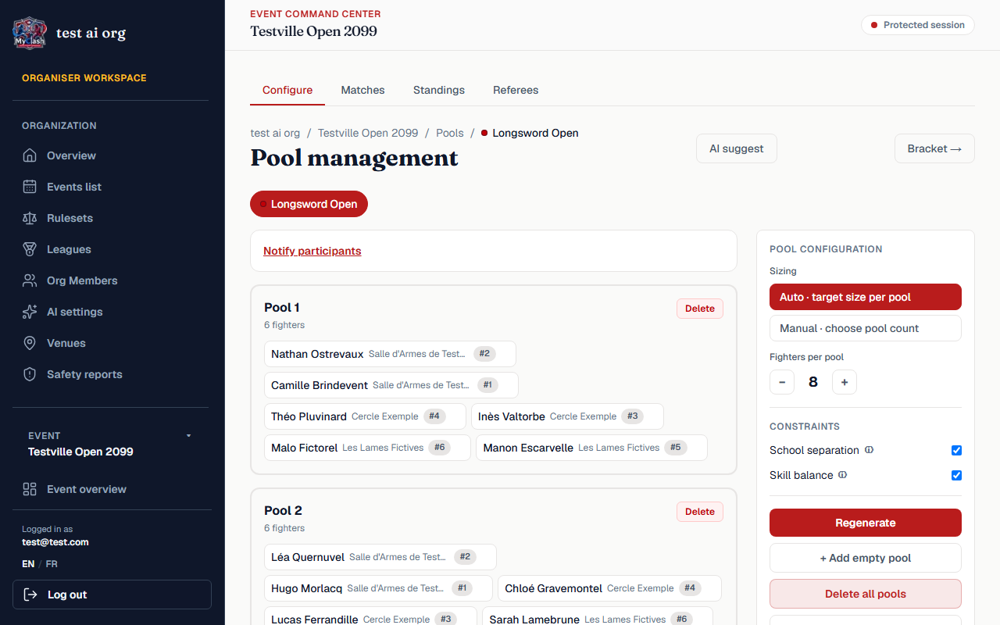
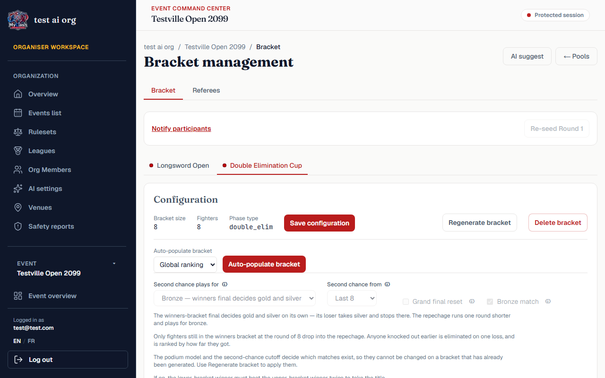
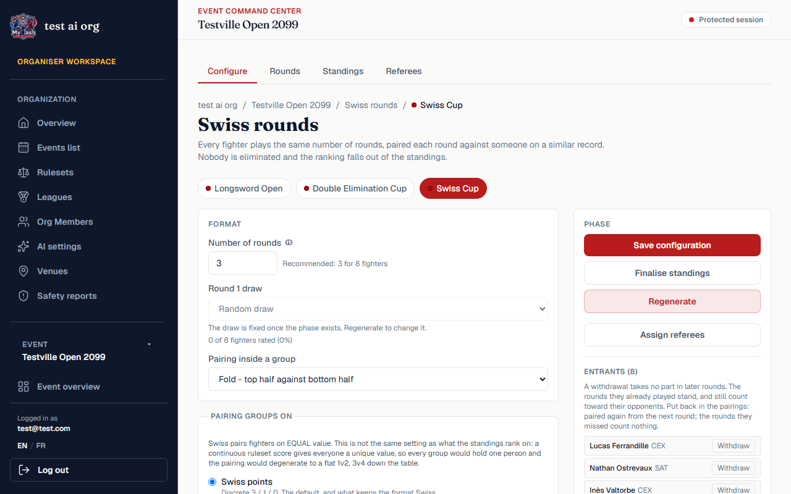

**What you'll learn:** the four formats MyClash runs, the settings that change them, and which one
to pick.

A tournament is made of **phases**. The usual shape is pools, then a bracket. You can also run
pools only, a bracket only, or Swiss rounds.

## Pools

Every fighter in a pool meets every other fighter once.

- **The draw**: MyClash spreads the seeds across the pools, then improves the draw. With
  **School separation** it keeps fighters of the same club apart; with **Skill balance** it
  spreads the strongest fighters.
- **The ranking** inside a pool follows the ruleset. With TF_v1: the pool score first, then the
  wins, then the fewest doubles, then the fewest hits received. With the points-cap ruleset: the
  wins, then the difference of points, then the points scored.

## Single elimination

The loser of a bout is out. The winner moves to the next round by themself.

- **Format**: **Single elimination**, with **Qualify count (top N from pools)**.
- When the field is not a power of two, MyClash keeps the largest power of two that fits and the
  extra fighters play a short round first (a play-in). Set
  **Bracket size override (power of 2, max …)** if you prefer byes.
- A bracket of 4 or more fighters always has a bronze match.

## Double elimination

A fighter must lose twice to be out. A first loss sends them to the losers bracket (the
repechage).

- **Second chance plays for**:
  - **Gold — losers bracket into a grand final**: the survivor of the losers bracket meets the
    winners-bracket champion in a grand final. With **Grand final reset** on, the losers-bracket
    fighter must win that final twice. Third place goes to the loser of the losers final.
  - **Bronze — winners final decides gold and silver**: the winners-bracket final decides gold and
    silver on its own, and the repechage plays for bronze. **Bronze match** decides third place;
    with it off, the last two of the repechage are ranked 3rd and 4th on pool score.
- **Second chance from**: **Everyone**, or only the fighters still in the winners bracket at a
  given depth (**Last …**). Anyone knocked out earlier is out on one loss.
- There are no byes: extra fighters play a play-in, and its losers are out at once. A double
  elimination bracket holds up to 128 fighters.
- Once generated, only **Grand final reset** can still change. For the rest, click
  **Regenerate bracket**.

## Swiss rounds

Every fighter plays the same number of rounds, each time against someone with a similar record.
Nobody is eliminated; the ranking comes from the standings.

- **Number of rounds**: 3 to 9.
- **Round 1 draw**: random, by rating, or by pool rank (this one needs a finished pool phase).
- **Pairing inside a group**: **Fold - top half against bottom half** or **Adjacent - 1v2, 3v4**.
  MyClash avoids rematches, and gives a bye to the lowest-ranked fighter who has not had one yet.
- Points: a win is 3, a draw 1, a loss 0, a bye 3. Ties are broken by Buchholz, then
  Sonneborn-Berger, then the ruleset's own order.
- The next round pairs itself when the last bout of the round ends.

## From the pools to the bracket

**Auto-populate bracket** fills the first round from the pool standings: **Global ranking** (the
best of all pools) or **Top-N per pool** (the first N of each pool). When the last pool bout ends,
MyClash fills a generated bracket by itself.

## Which one to pick

- _A club night or a short evening_: pools only, or Swiss rounds. Everyone fights several times
  and nobody waits long.
- _A classic open_: pools, then single elimination.
- _You want a lost bout to be forgiven_: double elimination, ideally with the second chance
  playing for bronze to keep the day short.
