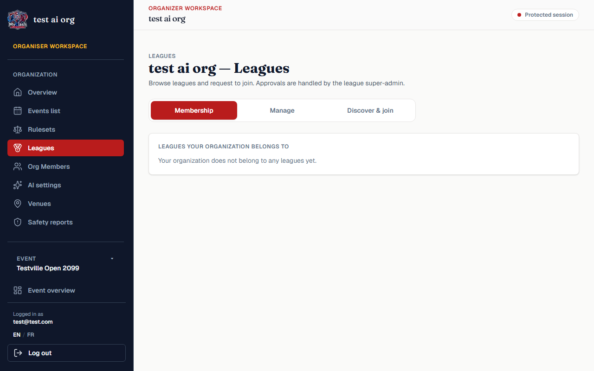

**What you'll learn:** what a league is, how your club joins one, how your tournaments count in
it, and when its standings change.

## What a league is

A league ranks fighters, and clubs, across several events of a season. Each tournament in the
league gives its fighters points for their final place. The league's ruleset says how many.

Only the MyClash team creates a league. Your club joins one, or manages one when the league makes
it an admin.

What counts:

- Only **Standard** events. A Test or Club event never counts (see
  [Before you start](/en/guide/before-you-start)).
- Only published tournaments, and only fighters with a final place.
- Nothing changes in a finalized season.

## Join a league

Open **Leagues** in your organisation's menu. It has three tabs: **Membership**, **Manage** and
**Discover & join**.

On **Discover & join**, click **Request to join** and add a message if you want. You need the
**Admin** role. An admin of the league accepts or refuses.

## Attach a tournament

Each tournament joins a league on its own. You need the **Admin** role.

- From the event's **Tournaments** page: click **Request league attachment**, choose the
  **League** and the **Tournament**, then **Submit request**.
- Or from **Leagues**: open **Attach a tournament**, choose, then **Attach**.

An admin of the league accepts or refuses the request. When it is accepted, your club also becomes
a member of the league.

**Withdraw** cancels a request. **Leave** takes an accepted tournament out of the league: its
points leave the standings at once. In a finalized season, they leave when the season is reopened.

## Manage a league

When your club is an admin of a league, **Manage →** opens it. The tabs are **Basics**,
**Ruleset**, **Groups**, **Tournaments**, **Requests** and **Admins**.

- **Basics:** the name, the description and the **Status**: Draft, Published or Archived. Only a
  published league is public. An archived league is hidden too.
- **Ruleset:** the **Scoring system** and the **Ranking dimension**: **Weapon only** (one table
  per weapon), **Weapon + group** (one table per weapon and group) or **Group only**. Custom
  points are set by the MyClash team.
- **Groups:** **Add group**, for example one per division. When a league has several groups, each
  tournament must name its group.
- **Requests:** the tournaments and clubs waiting for an answer: **Accept** or **Refuse**.
- **Admins:** the people and clubs who manage the league. A league always keeps at least one.

## When the standings change

The standings do **not** change when a bout ends. MyClash recalculates them when:

1. an event is completed;
2. an event changes between Standard and Test or Club;
3. a hit or a card of a completed event is corrected (on a completed event, a correction you ask
   for waits for approval first);
4. a tournament leaves the league.

The MyClash team can also recalculate a league by hand. Reopening a finalized season does not
recalculate it.

## What the public sees

A published league has its own page on app.myclash.fr: the fighters' standings, the **Club
standings**, the events of the league, a CSV and a printable report. The tournaments of a Draft or
Test event stay hidden.
