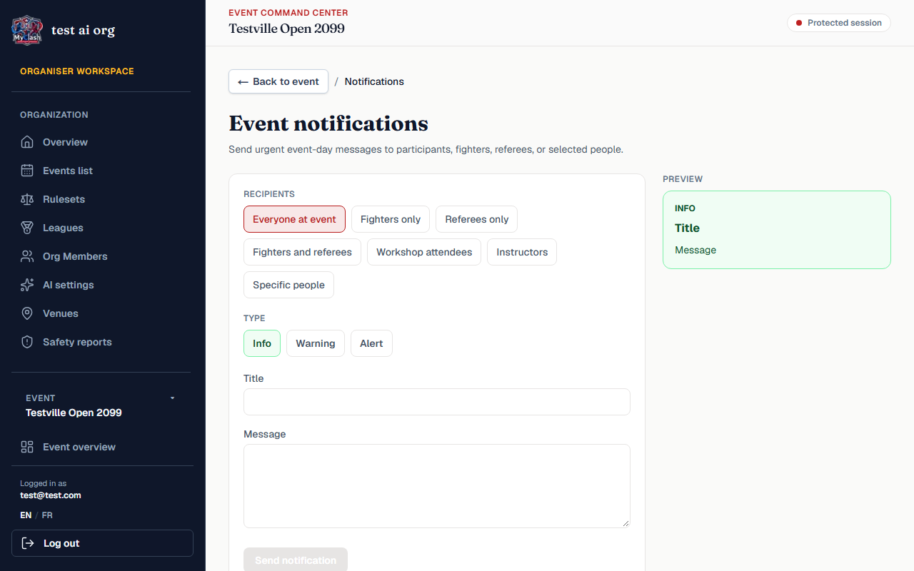

**What you'll learn:** what MyClash sends by itself, what you send by hand, and who receives what.

## How a notification arrives

A notification goes to the person's phone. When no phone answers, it goes by email instead. A
person turns them on in their personal space, with **Enable notifications**, and chooses there what
they want (see [For your fighters](/en/guide/for-fighters)).

**Automatic notifications need a MyClash account.** A person on your list with no account gets
none of them, only what you send by hand.

## What MyClash sends by itself

| When                                                | Who                                                                                                | Can they turn it off?                                          |
| --------------------------------------------------- | -------------------------------------------------------------------------------------------------- | -------------------------------------------------------------- |
| A bout is placed on the schedule                    | Its two fighters, and the people who follow them: a reminder before the bout (10 minutes at first) | Main switch only                                               |
| You press **Lock assignments** on the Referees page | Each referee: their assignment, then a reminder before their first bout                            | **Schedule changes** (the message); main switch (the reminder) |
| A workshop booking is confirmed                     | The person: a reminder before the session                                                          | Main switch only                                               |
| A workshop session moves or is cancelled            | Everyone booked, waiting list included                                                             | **Schedule changes** (a move)                                  |
| A place frees up on a waiting list                  | The person who gets it                                                                             | Main switch only                                               |
| A tournament is completed                           | All its fighters: the results are out                                                              | **Results published**                                          |
| A Swiss round is paired                             | Its fighters                                                                                       | **Swiss round paired**                                         |
| A Standard event is published for the first time    | The people who follow your organisation                                                            | **New events from organisers you follow**                      |

Since a tournament completes by itself when its bracket has a champion, or when its event completes
(see [What MyClash does by itself](/en/guide/automation)), the results notice goes out on its own.

**At a Draft event, nothing is sent**, except a waiting-list place. **At a Test event**, bout
reminders, referee messages and waiting-list places are sent; results and workshop changes are
not.

## What you send by hand

**The Notifications page** (in the event's menu, for an **Admin**): choose who, write, send.

- **Who:** **Everyone at event**, **Fighters only**, **Referees only**, **Fighters and referees**,
  **Workshop attendees**, **Instructors** or **Specific people** (up to 500).
- **Type:** Info, Warning or Alert.
- **Length:** a title up to 120 characters, a message up to 1000.
- It reaches every person, account or not: by phone, or by email to the address you hold for them.
  It is sent even to someone who turned notifications off.

**Notify participants**, on the Pools and Bracket pages, opens this page already filled in: the
fighters and referees of the tournament, and "Pools are ready" or its bracket version.

**Message the people booked**, in a workshop's roster: to everyone booked on a session. The
workshop's instructor can send it too.

**Email passes**, on the Participants page (**Editor** role): emails each person with no account
their pass for the welcome desk.

## What reaches you

- **Safety reports** from FightBook reach the admins and the owner of your organisation, by phone or
  email.
- Nothing else: photo reports, deletion requests and the like are not notified. Look at their pages.

## The worker

The automatic notifications and every message you send go through MyClash's background worker. If
it is not running, nothing leaves: a message stays waiting.
