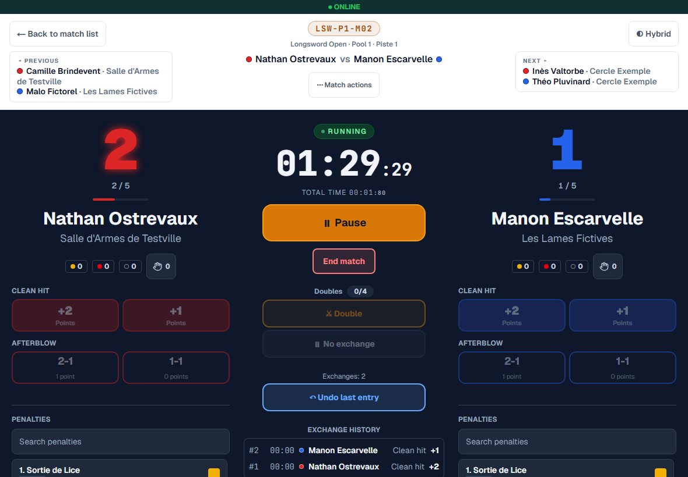
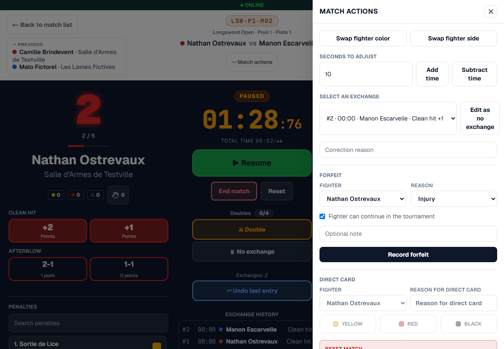

**What you'll learn:** every control of the scoring pad, in which state of the bout it works, and
what to do when something goes wrong. To train a volunteer, start with the
[Scorekeeper sheet](/en/guide/scorekeeper-sheet).

## Signing in

- The **Staff sign-in** link of your event opens the form with the event already filled in. An
  account's own link also fills in its **Username**: the volunteer types only the **PIN**.
- Without the link, the tablet shows a list of events to pick from.
- An organiser can sign in with their own account (the email form below the PIN form): with the
  **Scorekeeper** role or above, they can score any piste, without a PIN.
- **Your Lices** lists the pistes of the account. **Practice going offline**, on that page, runs a
  two-minute drill without network; it is refused while the tablet still has something to send.
- A piste's page shows the bout in progress, the next five bouts under **NEXT**, then all the
  bouts of the piste.

## The bout screen

At the top: **Back to match list**, the previous and the next bout of the piste, the bout code,
the tournament, phase and piste, both fighters, their gear check, and **Match actions**. The
theme button switches between Hybrid, Dark and Light.

## What works in which state

| Control                                                   | Not started                    | Clock running | Paused                                                           | Ended                                 |
| --------------------------------------------------------- | ------------------------------ | ------------- | ---------------------------------------------------------------- | ------------------------------------- |
| Main clock button                                         | **Start**                      | **Pause**     | **Resume**                                                       | **Re-open match** (needs the network) |
| **End match** (or **End round**)                          | —                              | yes           | yes                                                              | —                                     |
| **Reset** (the clock only, asks first)                    | —                              | —             | yes, until extra time or sudden death starts (needs the network) | —                                     |
| **Clean hit**, **Afterblow**, **Double**, **No exchange** | off                            | _off_         | yes                                                              | off                                   |
| Penalties                                                 | off                            | yes           | yes                                                              | off                                   |
| Protests                                                  | off                            | yes           | yes                                                              | yes                                   |
| **Undo last entry**                                       | whenever something was entered |               |                                                                  |                                       |

The exchange buttons are off while the clock runs: the referee halts, the scorekeeper pauses,
enters the exchange, and resumes.

**Keys:** the space bar starts and pauses the clock (it never reopens a bout), D enters a double,
U undoes the last entry. Keys do nothing while a dialog is open or a field is being typed in.

## Scoring

- **Clean hit** and **Afterblow** buttons come from the tournament's ruleset: their labels and
  values are the ruleset's.
- In pools and Swiss rounds, **Double** counts towards the limit shown as **Doubles** x/max. At the
  limit the bout ends as the tournament's settings say: a double loss, a draw, or the score stands.
- **No exchange** asks for the reason: **Out of bounds**, **Simultaneous stop**,
  **No valid hit** or another one.
- Under each fighter: the score, and the score against the point cap. At the cap the score turns
  gold. While exchanges wait to be sent, the pad says how many are not sent yet.
- _With the network, the bout ends by itself when a hit reaches the point cap_: the buttons turn
  off and the result appears. Without network, tap **End match** at the cap. Ending before the
  cap or the time asks "End the match now?" first.

## Penalties and protests

- Each fighter has quick buttons for the tournament's usual penalties, and **Search penalties**
  for the others.
- The pad shows the card the fighter will actually get: within a group of the penalty ruleset,
  each repeat earns the next card. A yellow card is given at once; a red or a black card asks
  first (**Issue card**). With the built-in FFAMHE ruleset, red costs one point and black loses
  the bout.
- The hand button records a protest, without a question. When a fighter goes past the
  tournament's protest limit, the pad offers the penalty chosen in the settings
  (**Give the card**).

## Match actions

**Match actions** opens the corrections:

- **Swap fighter color** and **Swap fighter side**;
- **Add time** and **Subtract time**;
- pick an exchange, then **Edit as no exchange** to cancel it (with a **Correction reason**);
- **Forfeit**: the fighter, the reason, and whether they can continue in the tournament, then
  **Record forfeit** (while the bout is running or paused);
- **Direct card**: a card without a penalty of the list, with its reason;
- **Reset match**: wipes the bout; you type RESET MATCH to confirm.

Everything in **Match actions** needs the network, except the direct card.

## Rounds, extra time and sudden death

- In a best-of bout, the header shows the round, **End match** becomes **End round**, and a break
  screen offers to start the next round.
- When the scores are level at the end of time, the pad offers the next step the tournament
  defines: **Extra time** or **Sudden death** (the bout then ends as soon as one fighter leads).
  The pad refuses to end a level bout that must be decided.
- Resuming once the time is up asks first: close, end the bout, or continue anyway.

## Without wifi

| The bar says                           | What it means                                                                                                 |
| -------------------------------------- | ------------------------------------------------------------------------------------------------------------- |
| **ONLINE**                             | All sent.                                                                                                     |
| **SYNCING**                            | Entries are being sent.                                                                                       |
| **OFFLINE - exchanges queued locally** | No network: keep scoring, the tablet keeps everything.                                                        |
| **SYNC ERROR**                         | Sending failed: **Retry**.                                                                                    |
| Hits not recorded, **Review**          | The server refused an entry: open **Review** to retry or discard it. Until then, the rest of that bout waits. |

- _Queued without network:_ hits, cards, protests, the clock (start, pause, resume, end), rounds
  and extra time.
- _Needs the network:_ **Re-open match**, clock **Reset**, unlocking a bout, forfeits, and
  everything in **Match actions** except the direct card.
- A bout ended offline says "Ended on this tablet. The server has not confirmed it yet." It cannot
  be reopened until the network is back.

### How the tablet keeps your entries

- Every tap is saved on the tablet first, then sent. If the tablet cannot save it, the pad says
  "Not saved on this tablet. Tap it again."
- The entries stay in the browser's storage: reloading the page or signing out keeps them. After a
  sign-in they are sent as soon as a bout is opened, and the sign-in page says how many wait.
- They belong to that browser. A private window or another browser on the same tablet holds its
  own queue, and clearing the browser's data deletes the entries not sent yet.
- The pad asks the browser to keep this storage, so that a tablet short of space does not clear
  it on its own.

### Opening the pad without network

- Once the pad has been opened with the network, the tablet keeps the app: its pages open without
  network, a bout page included. A page the tablet did not keep opens the start page instead, or,
  when even that is gone, a page that says "You're offline" with **Try again**.
- The tablet also keeps a copy of its piste: the bouts, their scores and clocks, and the
  tournament's rules. It refreshes the copy every 5 minutes while a screen of the piste is open.
- Without network, a bout opens from that copy and says so: "No connection. This is the match as
  this tablet read it on…". The score shows **not confirmed**.
- A bout being scored on another tablet is not in the copy: it says "This match is not loaded
  yet. It opens when the network is back."
- Before the event, open the piste list on each tablet with the network on, then run **Practice
  going offline** once.

### How the entries are sent

- In the order they were tapped. The tablet sends after every tap, when a bout or the piste list
  opens, when the network comes back, and every 5 seconds while the bar says **OFFLINE** and the
  wifi is still on.
- An entry sent twice counts once: each one carries its own identity.
- On **SYNC ERROR** the tablet does not try again by itself: tap **Retry**.
- An entry the server refuses goes to **Review**. It is held there, never deleted: **Retry** it
  once the cause is fixed, or discard it if you already entered it again by hand. The entries of
  that bout wait behind it; other bouts carry on.
- When the session ends, the bar says **SESSION ENDED**: sign in again, and the queue is sent.

### The score on the tablet and the score that counts

- Without network, the pad shows the server's last score plus the entries it still holds,
  calculated with the tournament's ruleset. The score then says "includes … not yet sent".
- Once the entries are sent, the tablet reads the bout again and the server's score replaces its
  own. The server's score is the one that counts.

### How the tablet gets news

The tablet does not receive live updates; it reads again:

- the piste list every 20 seconds, and when the network comes back;
- the bout after every send, and when the network comes back.

So a change made elsewhere (another tablet, an organiser, a schedule move) shows at the next read.
When the organiser changes the rules of a bout, the pad says "The organiser changed the rules of
this match." A new version of the pad installs itself at the next page opened with the network,
without asking.

### The clock without network

- The clock keeps running on the tablet, and Start, Pause, Resume and End are queued like hits.
- A tablet whose date or time is wrong still times the bout right: the server uses how long ago
  each press was made, not the tablet's clock. A press more than a day old is refused.

### What the other screens see

- The public bout page, the live boards and the hall screens show only what reached the server.
  Entries still on a tablet appear as soon as they are sent.
- The organiser's live control room shows each tablet's queue and how many of its entries the
  server refused (they wait in **Review**), and **Sync lagging** when an entry waits over a
  minute, **Sync stuck** over five minutes.
- A tablet checks in every 20 seconds while it has the network. With a bout on its piste and no
  check-in for a minute, its row turns amber and reads "No news for 2 mins"; after five minutes it
  turns red. Its **Last seen** line says when it last checked in.
- Nothing stops two tablets from scoring the same piste. Keep one tablet per piste: a clock press
  that meets the other tablet's press goes to **Review**.

## Locks and who may undo

- A finished pool or bracket locks itself 15 minutes after its last bout (the tournament's
  **Auto-lock** settings). A locked bout shows a banner and refuses scoring and corrections.
- An organiser (**Editor** or above) can always reopen a locked bout. A tablet account can only
  when the tournament's auto-lock is off.
- A tablet account scores only the pistes it is assigned to.

