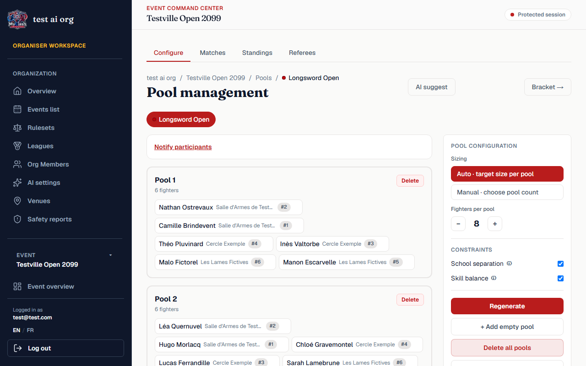

**What you'll do:** split a tournament's fighters into pools, adjust them by hand, and make them
public.

## Generate the pools

1. On your event, open **Pools**. The page is called **Pool management**. Pick your tournament
   from the coloured chips at the top.
2. Choose how to size the pools:
   - **Auto · target size per pool**: you set **Fighters per pool** (8 to start), and MyClash
     works out how many pools that makes.
   - **Manual · choose pool count**: you set the **Number of pools** yourself.
3. Under **Constraints**, leave **School separation** on to keep fighters of the same club apart,
   and **Skill balance** on to spread the strongest fighters across pools.
4. Click **Generate pools**.

The page then opens the **Matches** tab: every bout of every pool. **Standings** shows the
ranking inside each pool as bouts are scored.

## Adjust by hand

- Drag a fighter onto another pool to move them, or onto the unassigned list to take them out.
- **+ Add empty pool** adds a pool you fill by hand.
- **Regenerate** starts the draw again.

## Show the pools to the fighters

There is no separate switch for the pools. Fighters see them as soon as the **tournament** is
public (and the event too). **Notify participants** opens a message to the fighters, already
filled with "Pools are ready".

<aside class="guide-warn">
  
<strong>Hard to undo.</strong> <strong>Regenerate</strong> and <strong>Delete all pools</strong>
  delete the pools and all their bouts. Once a bout has been scored, a pool can no longer be
  changed: moving a fighter, renaming or deleting it is refused. Only the organisation's owner can
  then throw away scored bouts. Check the pools before the first bout.

</aside>
