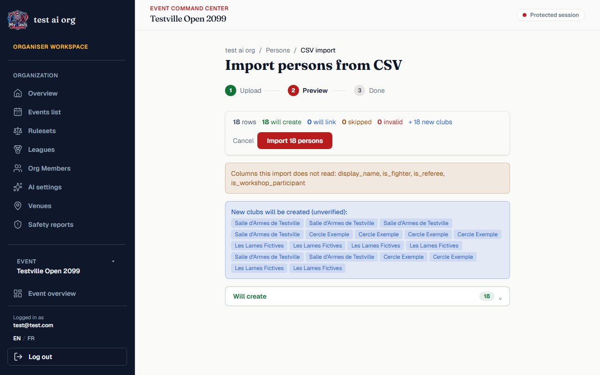
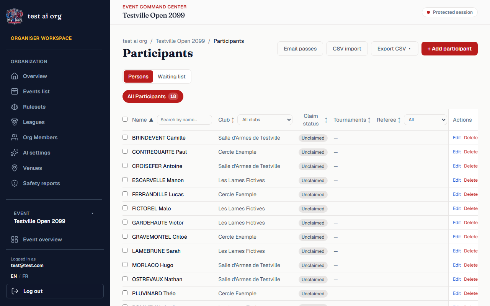

**What you'll do:** put your fighters on the event's roster, then enter them in a tournament.

Two separate steps: first a person joins the **event's roster** (the **Participants** page), then
you **enter them in a tournament**. A CSV import does the first step only.

## One by one

1. On your event, open **Participants** and click **+ Add participant**.
2. Search the global profiles by name first: a fighter who has fought on MyClash before already
   has a profile. If they are not there, fill in **Given name**, **Family name** and, if you can,
   **Email**, **Club** and **HEMA Ratings ID**.
3. Under **Register in tournaments (optional)**, tick the tournaments they enter.
4. Tick **Also register as referee** if they referee too.
5. Click **Save**, or **Save and add another**.

A person with no club, no email and no HEMA Ratings ID cannot be recognised at your next events.
Give at least one of them.

## From a CSV file

1. On **Participants**, click **CSV import**.
2. **Upload**: drop your file, or click **Download template** to get one. Click **Validate →**.
3. **Preview**: MyClash shows how many rows **will create**, **will link**, are **skipped** or
   **invalid**.
   - **Duplicates (need a decision)** lists rows that look like a fighter who already has a
     profile. For each, choose **Link to existing profile** (the same person) or
     **Create new profile** (a different person). **Link all suggested** and
     **Create all as new** set every row at once.
   - Columns the import does not read are listed in an orange box.
4. Click **Import … persons**, then **Back to roster**.

The columns the import reads (a comma or a semicolon between them both work):
`given_name`, `family_name` (both required), `email`, `club`, `club_abv`, `club_city`,
`hema_ratings_id`, `date_of_birth` (DD/MM/YYYY or YYYY-MM-DD), `gender_category`, `notes` and
`weapons`. French headers work too (`prenom`, `nom`, `courriel`…). A club MyClash does not know
yet is created.

## Enter them in a tournament

The import puts people on the roster but in no tournament. On **Participants**, tick the
fighters, choose **Assign to tournament…**, pick the tournament and click **Assign**.

<aside class="guide-warn">
  
<strong>Hard to undo.</strong> Once a fighter has a bout that started, finished or was
  forfeited, you can no longer delete them or take them out of the tournament.

</aside>
