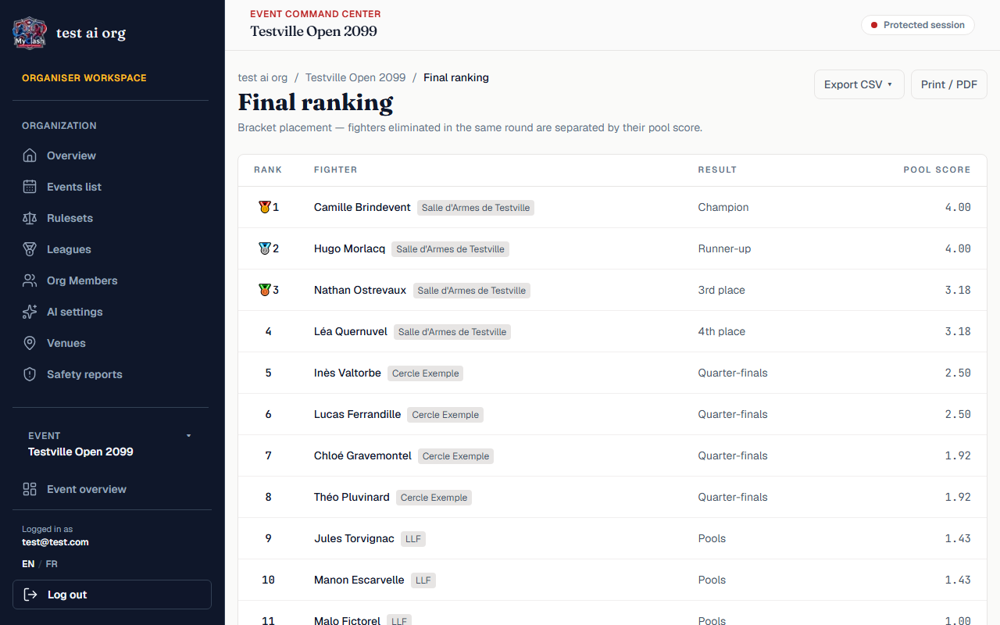

**What you'll do:** check the final ranking, make your event and its results public, and send
them to HEMA Ratings.

## The final ranking

On your event, open **Final ranking**. Fighters are ranked by how far they went in the bracket;
those out in the same round are ranked by their pool score. **Export CSV** downloads it, and
**Print / PDF** prints it.

## Make it public

Two switches, both needed:

1. **The event.** On **Event overview**, the **Event visibility** card has the switch: **Set
   public** publishes the event, **Set draft** takes it back. If something is not ready yet,
   MyClash asks first and offers **Publish anyway**.
2. **Each tournament.** On the same page, each tournament has its own pill: **Draft** or
   **Public**. A tournament starts as a draft.

The public sees a tournament's pools, bracket and results only when both the event and the
tournament are public. A test event is never public.

## HEMA Ratings

Open **HEMA Ratings**, click **Download submission bundle**, unzip it, and send it through the
HEMA Ratings submission portal (the page links to it). Only a **Standard** event can do this: a
test or club event shows a message saying its results do not count toward ratings.

<aside class="guide-warn">
  
<strong>Hard to undo.</strong> The first time you publish a Standard event, MyClash tells
  your organisation's followers. Setting it back to draft does not take that message back.
  Marking a public tournament as completed also notifies its fighters.

</aside>
