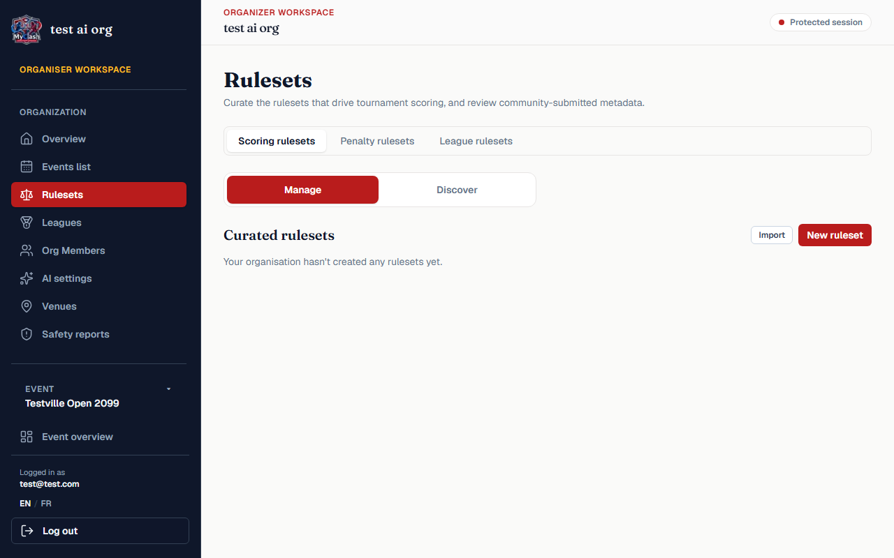
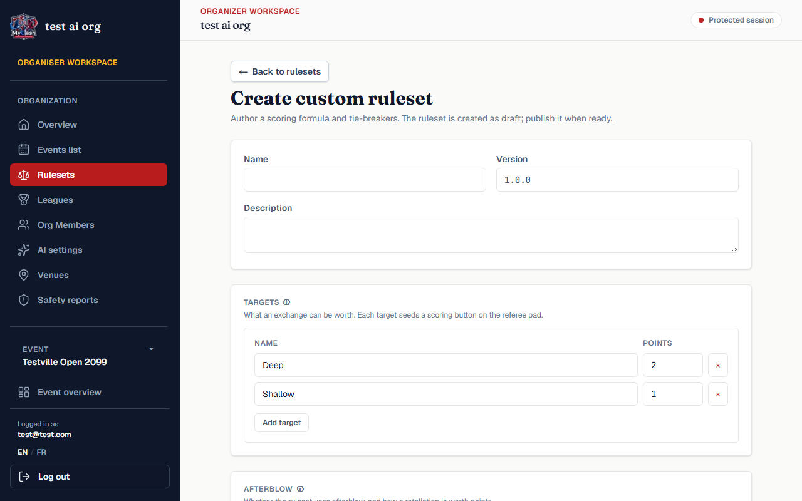

**What you'll learn:** what a ruleset decides, the ones MyClash ships, and how to create your own
scoring and penalty rulesets.

A tournament has two rulesets:

- a **scoring ruleset**: what each hit is worth, how a pool is ranked, and the buttons the
  scoring pad shows;
- a **penalty ruleset**: the list of penalties the pad offers, and the card each repeat earns.

Open **Rulesets** in your organisation menu to see them all.

## The built-in scoring rulesets

- **TF_v1**: a deep hit is worth 2, a shallow hit 1. The pool score is the wins (3 each) plus the
  points scored, divided by the hits received plus a penalty that grows with the doubles. Pools
  are ranked by that score, then the wins, then the fewest doubles, then the fewest hits received.
- **Points Cap (Premier à N points)**: the first fighter to reach the point cap wins. One target, worth 1.
  Pools are ranked by wins, then the difference of points, then the points scored.

## Create your own scoring ruleset

You need the **Admin** role (or **Owner**) in your organisation.

1. On **Rulesets**, click **New ruleset**, or **Clone** next to a ruleset you want to start from.
2. Fill in the form:
   - **Name**, **Version** and **Description**.
   - **Targets**: what an exchange can be worth. Each target becomes a scoring button on the pad.
     Add one with **Add target**.
   - **Afterblow**: tick **This ruleset uses afterblow**, then choose the **Retaliation value**
     (**Fixed value** or **Value of the target hit**) and the **Default afterblow mode**
     (**Full** or **Deductive**).
   - **Constants** and **Double-hit penalty**: the values the formula uses.
   - **Score formula**: how a fighter's pool score is calculated. You build it from numbers, the
     fighter's results (wins, draws, losses, doubles, hits given, hits received, points received)
     and the four operations. Under the formula, **What each word means** explains each one: hits
     received counts how many times the fighter was hit, points received adds up what those hits
     were worth. If the bottom of a division is zero, the formula divides by 1. MyClash checks the
     formula; it never runs code typed in a form.
   - **Tie-breakers**: the order that separates fighters with the same score.
3. Save. The ruleset is usable in your tournaments straight away.

_Versions._ Once a tournament uses a version of your ruleset, that version can no longer be
edited: change the **Version** and save a new one.

_Sharing._ **Submit for review** asks the MyClash team to share your ruleset with other
organisations. The review only decides the sharing: your own tournaments can use the ruleset
before, during and after it.

## Penalty rulesets

The built-in one is **Penalty - Tournois fédéraux FFAMHE**: 28 penalties in 5 groups, counted per
bout. A yellow card costs nothing, a red card costs one point, and a black card loses the bout; a
second black card puts the fighter out of the tournament. Within a group, each repeat earns the
next card of the list, and the last card repeats.

To create your own: on **Rulesets**, open the penalty rulesets and click
**New penalty ruleset**. Set the **Code**, the **Accumulation scope**, whether it is
**Visible to other organisations**, the **Card costs & forfeit scope**, then the **Entries**:
**Add group**, then **Add entry** for each penalty, with its cards in the order they escalate.

Once a tournament uses a penalty ruleset, it is frozen: clone it to make changes.

## Protests

In a tournament's settings, on the **Display** tab, **Protest limit** caps the protests per
fighter and per bout (empty means no limit). **Penalty offered past the limit** chooses the
penalty the pad offers when a fighter protests once more.

<aside class="guide-warn">
  
<strong>Hard to undo.</strong> Once a bout of a tournament has started, its ruleset is
  locked. Only the organisation's owner can change it, with <strong>Re-pin ruleset</strong> and a
  public reason.

</aside>
