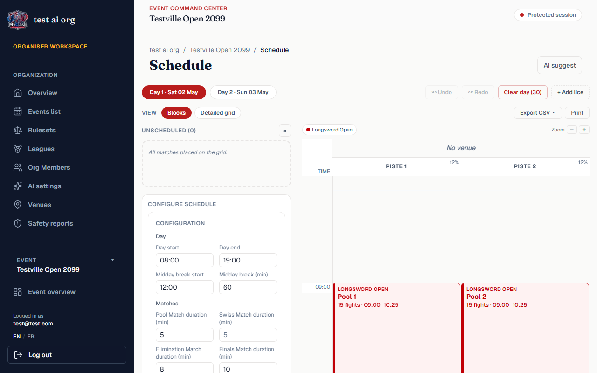

**What you'll do:** decide when and on which piste each bout is fought.

## Set the day

On your event, open **Schedule**. In the **Configure schedule** panel, fill in:

- **Day start** and **Day end**;
- the bout length in minutes, for pools, Swiss rounds, elimination and finals;
- **Midday break start** and **Midday break (min)**.

Each day of the event has its own tab at the top (Day 1, Day 2…).

## Place the bouts

1. **Generate schedule** proposes blocks of time for each tournament phase, on your pistes.
2. **Generate Grid** places each bout of those blocks on a piste, at a time. It asks first:
   existing placed bouts are overwritten.
3. Adjust by hand: drag a group from **Unscheduled** onto a cell, or move a bout on the grid.
   **Detailed grid** shows every bout; **Blocks** shows the overview.
4. **+ Add lice** adds a piste if you are short of one.

**Undo** and **Redo** take back the last moves of a bout, but not everything: clearing a day, a
group drop and moving a whole block cannot be undone this way.

<aside class="guide-warn">
  
<strong>Hard to undo.</strong> <strong>Clear day</strong> empties a whole day, and
  <strong>Generate Grid</strong> overwrites the bouts already placed. Neither can be taken back with
  <strong>Undo</strong>.

</aside>
