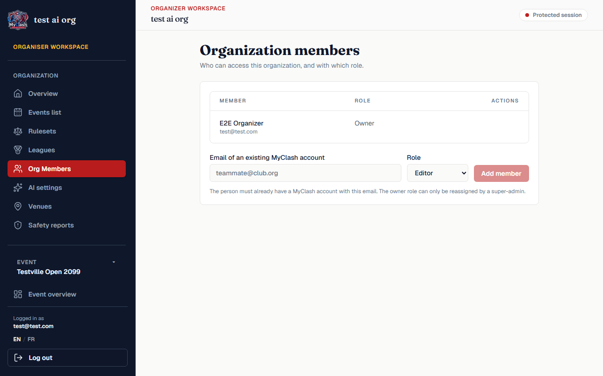
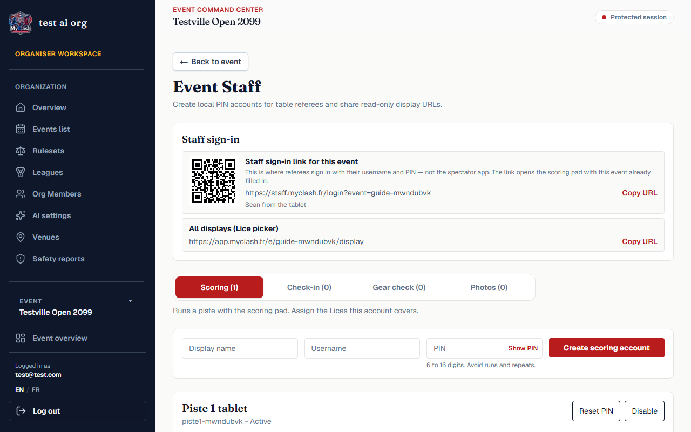

**What you'll learn:** the two kinds of access MyClash has, organisation members and tablet
accounts, and how referees fit in.

## Organisation members

A member signs in with their own MyClash account and works in the organiser workspace. Their
**role** decides what they can do. Each role can do everything the roles below it can.

| Role                        | What it adds                                                                                                                                               |
| --------------------------- | ---------------------------------------------------------------------------------------------------------------------------------------------------------- |
| **Owner**                   | The organisation's settings; adding and removing members; changing a locked ruleset                                                                        |
| **Admin**                   | Creating events; generating and changing pools, brackets and Swiss rounds; referee qualifications; scoring and penalty rulesets; the member list; the logo |
| **Editor**                  | Running events: pistes, the schedule, referee assignments, tablet accounts; reopening a locked bout                                                        |
| **Instructor**, **Referee** | Their workshops and referee duties                                                                                                                         |
| **Scorekeeper**             | Scoring bouts on the pad with their own account, on any piste, without a PIN; the live room                                                                |
| **Read only**               | Seeing the organisation's events, drafts included                                                                                                          |

To add a member, open **Org Members**. Type the **Email of an existing MyClash account**, choose
the **Role**, and click **Add member**. Only the owner can add or **Remove** members. The person
must already have a MyClash account. The owner cannot be removed, and only the MyClash team can
give the owner role to someone else.

## Tablet accounts

A tablet account belongs to one event. It has no email: a volunteer signs in with a username and
a PIN. Create them on the event's **Event Staff** page (you need the **Editor** role).

| Kind           | What the tablet opens                                                  |
| -------------- | ---------------------------------------------------------------------- |
| **Scoring**    | The list of its pistes, then the scoring pad                           |
| **Check-in**   | The welcome desk                                                       |
| **Gear check** | The equipment check                                                    |
| **Photos**     | The moderation of the photos people send (until the event is archived) |

- **Username**: 3 to 64 characters, letters, digits, dots, dashes and underscores.
- **PIN**: 6 to 16 digits. Runs, repeated digits and common PINs are refused.
- A scoring account scores only the pistes under its **Lice assignments**.
- The **Staff sign-in** link (and its QR code) opens the sign-in with your event filled in. Each
  account also has its own link that fills in the username, so the volunteer only types the PIN.
- **Disable** stops an account at once; **Enable** brings it back; **Reset PIN** gives it a new
  PIN. An account cannot be deleted.

## Referees

A referee is not an account. A referee is a person of your event that you add on the
**Referees** page, with their qualifications. If that person has a MyClash account linked to
their fighter profile, they also see their duties in their personal space.
