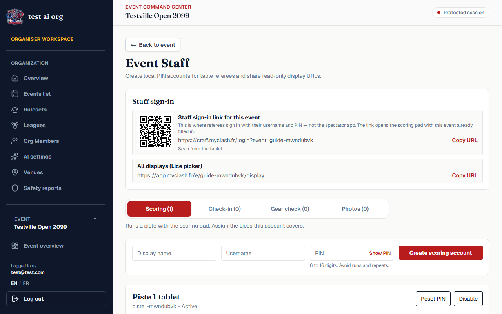
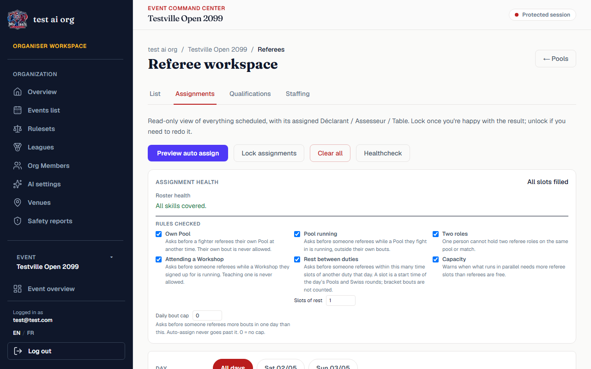

**What you'll do:** give each scoring tablet an account, add your referees, and let MyClash
assign them.

## The scoring tablets

On your event, open **Event Staff**.

1. The **Staff sign-in** box holds the sign-in link for your tablets, with a QR code to scan from
   the tablet. The link opens the scoring pad with your event already filled in.
2. On the **Scoring** tab, fill in **Display name** (for example "Piste 1 tablet"), **Username**
   and **PIN**, then click **Create scoring account**. The PIN has 6 to 16 digits; MyClash refuses
   easy ones such as 123456 or 111111.
3. Under **Lice assignments**, give the account the pistes it scores. An account scores only the
   pistes it is assigned to.

The other tabs (**Check-in**, **Gear check**, **Photos**) make accounts for your welcome desk,
your equipment check and your photo moderators.

An account cannot be deleted, only disabled. A disabled account's username cannot be reused.

## The referees

Open **Referees**. The **Referee workspace** has four tabs: **List**, **Assignments**,
**Qualifications** and **Staffing**.

1. **List**: search a person of your event in **Add referee**, and click **+ Add**.
2. **Qualifications**: record what each referee can do: declaring referee, assessor or table.
   A referee needs a global profile for this; link one first if MyClash asks.
3. **Assignments**: click **Preview auto assign**. MyClash proposes a referee for every role of
   every pool. Check it, then click **Apply auto assign**. When you are happy, click
   **Lock assignments**.

## The rules MyClash checks

Some rules have no switch: nobody referees their own bout, nobody referees while they fight,
referee elsewhere or teach a workshop at the same time, and nobody referees outside the
availability they declared.

The others are checks you can switch off under **Rules checked**: **Own Pool** (refereeing a pool
you fight in, at another time), **Pool running** (refereeing while your own pool runs elsewhere),
**Two roles**, **Attending a Workshop**, **Rest between duties** and **Capacity**, plus a
**Daily bout cap** (0 means no cap).

<aside class="guide-warn">
  
<strong>Hard to undo.</strong> <strong>Clear all</strong> deletes every assignment. While the
  assignments are locked, auto-assign and <strong>Clear all</strong> are off: click
  <strong>Unlock assignments</strong> first.

</aside>
