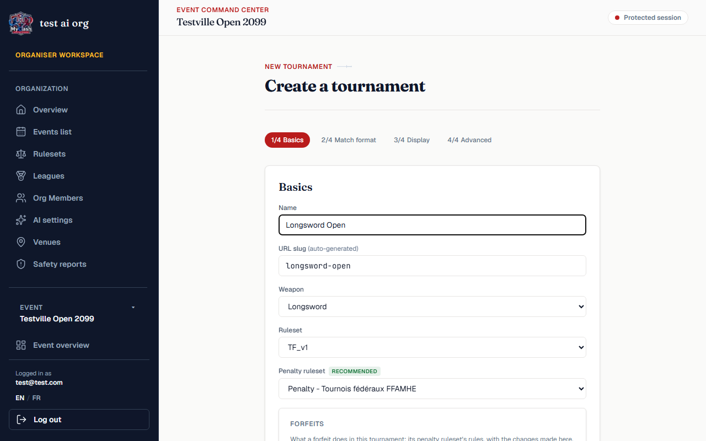
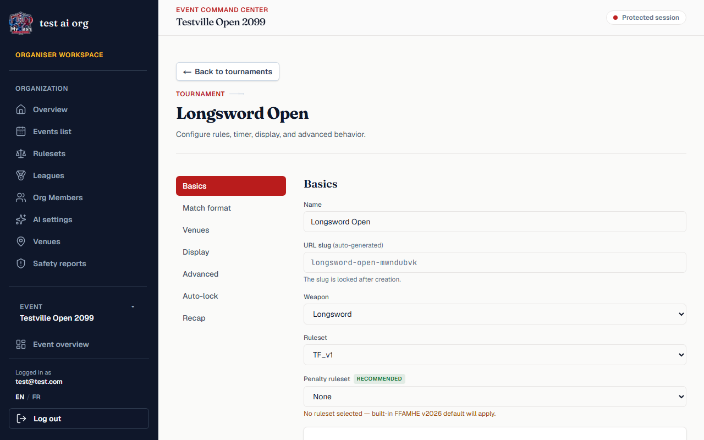

**Ce que vous allez faire :** ajouter un tournoi à votre événement et choisir son arme, son
règlement et le format de ses matchs.

Un événement contient un ou plusieurs tournois : par exemple un tournoi d'épée longue et un de
sabre.

## Créer le tournoi

Sur votre événement, ouvrez **Tournois** et cliquez sur **Créer un tournoi**. Le formulaire a
quatre étapes : **Bases**, **Format des matchs**, **Affichage**, **Avancé**.

1. **Bases**
   - **Nom**. Le **Slug URL** est généré à partir du nom, et l'**Arme** est devinée à partir de
     lui. Vérifiez les deux.
   - **Règlement** : la façon de compter un combat. Il démarre sur **TF_v1**.
   - **Règlement de pénalités** (marqué **Recommandé**) : la liste des pénalités que propose la
     tablette de score. Laissé vide, la liste FFAMHE 2026 intégrée s'applique.
   - **Participants max.** et **Liste d'attente max.**, si vous voulez une limite. Une limite de
     liste d'attente n'a de sens qu'avec une limite de participants.
   - Dès que vous cliquez sur **Suivant** ici, le tournoi est enregistré en brouillon.
2. **Format des matchs** : la limite de points, le chronomètre, la durée des combats en poules,
   en tableau et en finale, les doubles touches et les contre-frappes.
3. **Affichage** : l'apparence du tournoi sur les pages publiques et les écrans.
4. **Avancé** : les lices du tournoi, et **Publier à la fin** si vous voulez qu'il soit public
   tout de suite. **Utiliser les défauts et terminer** saute ce que vous n'avez pas modifié.
   Cliquez sur **Terminer**.

## Modifier les réglages plus tard

Chaque tournoi a une page de **réglages** avec les mêmes onglets, plus **Verrouillage auto** et
**Récap**. Modifiez ce qu'il faut et cliquez sur **Enregistrer**.

<aside class="guide-warn">
  
<strong>Difficile à annuler.</strong> Le slug URL du tournoi est verrouillé dès sa création.
  Et une fois un combat commencé, le règlement et les règles de score ne se changent plus
  librement : seul le propriétaire de l'organisation le peut, avec
  <strong>Modifier le règlement</strong> et une raison publique. Fixez les règles avant le premier
  combat.

</aside>
