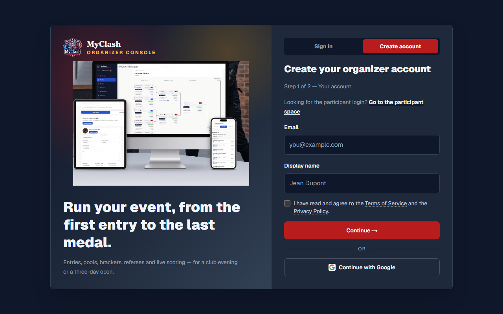
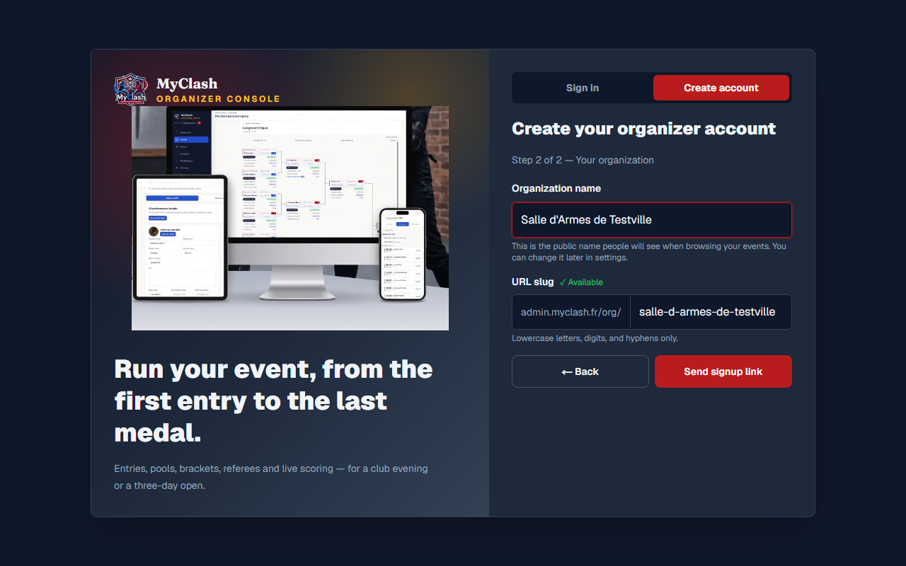
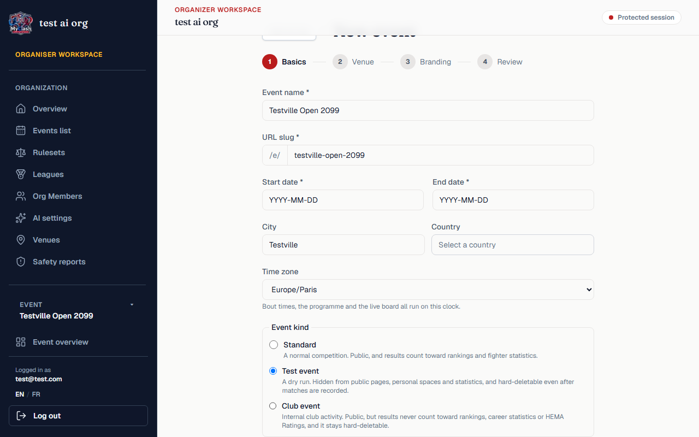

**Ce que vous allez faire :** créer votre compte et votre organisation, puis choisir le type de
votre premier événement.

## Créer votre compte

1. Ouvrez [admin.myclash.fr/signup](https://admin.myclash.fr/signup).
2. **Étape 1 sur 2 — Votre compte** : saisissez votre **E-mail** et votre **Nom affiché**, acceptez
   les conditions, puis cliquez sur **Continuer →**.

   

3. **Étape 2 sur 2 — Votre organisation** : saisissez le **Nom de l'organisation** (le nom public
   que les gens verront, par exemple celui de votre club). Le **Slug d'URL** se remplit tout seul.
   C'est l'adresse web de votre organisation : lettres minuscules, chiffres et tirets uniquement.
   Attendez la mention **✓ Disponible**.

   

4. Cliquez sur **Envoyer le lien d'inscription**.
5. Ouvrez l'e-mail que vous recevez et cliquez sur le lien. Vous choisissez votre mot de passe, et
   votre organisation s'ouvre : vous pouvez créer votre premier événement tout de suite.

## Choisir le type d'événement

Quand vous créez un événement, MyClash vous demande son **Type d'événement**. Ce choix décide qui
voit l'événement et si ses résultats comptent. Les captures d'écran de ce guide montrent
l'application en anglais ; les libellés cités dans le texte sont ceux de la version française.

| Type                  | Le public le voit ?                      | Compte dans les classements, les statistiques de carrière et les ligues ? | Export HEMA Ratings | Vos abonnés sont prévenus à la publication | Supprimable même avec des résultats |
| --------------------- | ---------------------------------------- | ------------------------------------------------------------------------- | ------------------- | ------------------------------------------ | ----------------------------------- |
| **Standard**          | Oui, une fois publié                     | Oui                                                                       | Oui                 | Oui                                        | Non                                 |
| **Événement de test** | Jamais (seuls les membres de votre club) | Non                                                                       | Non                 | Non                                        | Oui                                 |
| **Événement de club** | Oui, une fois publié                     | Non (seulement ses propres pages de résultats)                            | Non                 | Non                                        | Oui                                 |

Tant qu'un événement est en **brouillon**, le public ne le voit pas, quel que soit son type. Les
membres de votre club peuvent toujours l'ouvrir.

## Lequel choisir ?

- **Vous voulez juste essayer MyClash :** créez un **Événement de test**. Publiez-le, lancez des
  poules, comptez des combats, cassez des choses. Personne en dehors de votre club ne le voit, il
  ne touche aux statistiques de personne, et vous le supprimez quand vous voulez.
- **Vous organisez une vraie compétition :** créez un **nouvel** événement de type **Standard**. Ne
  transformez pas votre événement de test en vrai événement : ses combats d'entraînement et ses
  combattants viendraient avec lui.
- **Vous organisez une soirée club ou un passage de grade :** choisissez un **Événement de club**.
  Il est public, pour que vos membres le suivent, mais il ne change le classement de personne.

<aside class="guide-warn">
  
<strong>Difficile à annuler.</strong> Un Événement standard qui a des résultats ne peut plus
  être supprimé. Faites vos essais dans un événement de test d'abord.

</aside>
