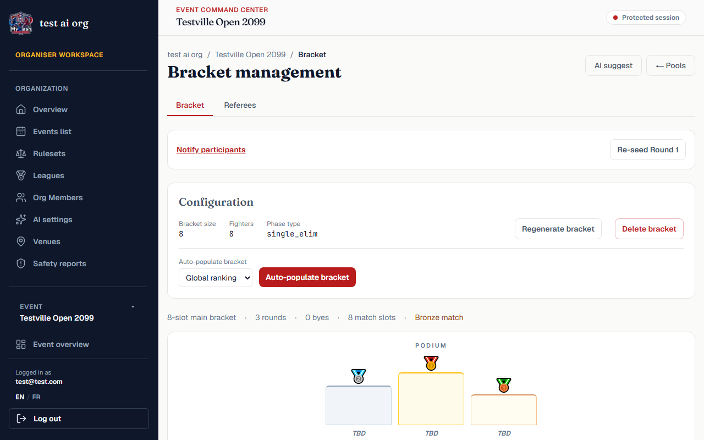

**Ce que vous allez faire :** créer le tableau d'élimination et le remplir avec les meilleurs
combattants des poules.

## Générer le tableau

1. Sur votre événement, ouvrez **Tableau**. La page s'appelle **Gestion du tableau**.
2. Choisissez le format (**Élimination directe** ou **Double élimination**) et combien de
   combattants se qualifient depuis les poules.
3. Cliquez sur **Générer le tableau**.

## Le remplir à partir des poules

Quand les poules sont finies, cliquez sur **Remplir le tableau**. Choisissez
**Classement général** (les meilleurs de toutes les poules) ou **Top-N par poule** (les N premiers
de chaque poule). MyClash place les combattants au premier tour selon le classement des poules,
et signale toute égalité à la limite de qualification.

Les combats du tableau se marquent ensuite sur la tablette, comme ceux des poules. Chaque
vainqueur passe seul au tour suivant.

Si un résultat de poule change après le remplissage du tableau, un bandeau le signale et propose
la correction. **Re-tirer le 1er tour** replace le premier tour, tant qu'aucun de ses combats n'a
commencé.

<aside class="guide-warn">
  
<strong>Difficile à annuler.</strong> <strong>Régénérer le tableau</strong> et
  <strong>Supprimer le tableau</strong> suppriment tous les combats du tableau, avec leurs
  échanges, cartons et affectations d'arbitres. Dès qu'un combat a eu lieu, seul le propriétaire
  de l'organisation peut encore le faire.

</aside>
