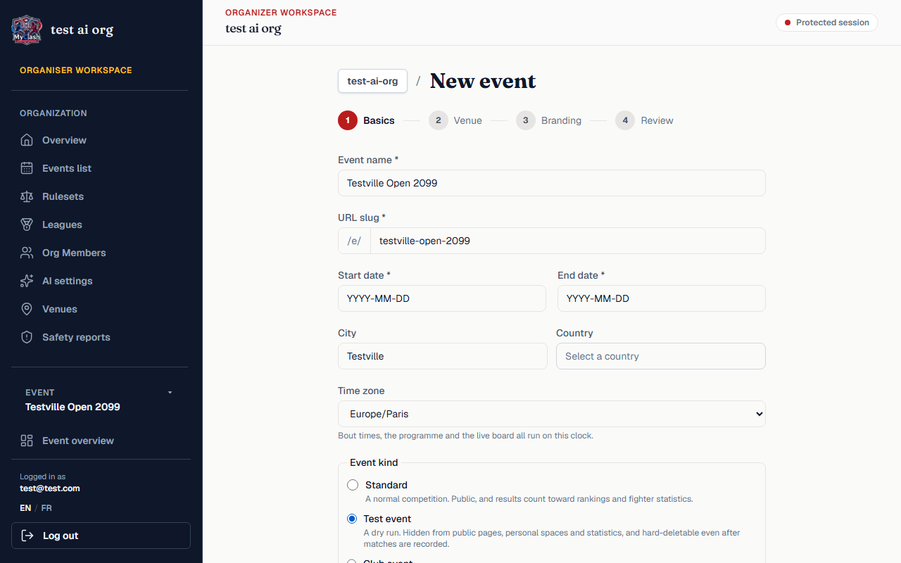

**Ce que vous allez faire :** créer l'événement : son nom, ses dates, son type, son lieu et ses
lices.

## Les quatre étapes

Dans votre espace organisateur, ouvrez **Liste des événements** et cliquez sur
**Créer un événement**. Un formulaire en quatre étapes s'ouvre : **Bases**, **Lieu**,
**Identité visuelle**, **Validation**. Cliquez sur **Suivant** pour avancer, ou sur **Retour**
pour corriger.

1. **Bases**
   - **Nom de l'événement**. Le **Slug URL** se remplit à partir du nom. C'est l'adresse web de
     l'événement : lettres minuscules, chiffres et tirets uniquement.
   - **Date de début** et **Date de fin**. Si vous placez la date de début après la date de fin,
     la date de fin suit.
   - **Ville**, **Pays** et **Fuseau horaire**. Le fuseau compte : les horaires des combats, le
     planning et le tableau en direct suivent tous cette heure.
   - **Type d'événement** : **Standard**, **Événement de test** ou **Événement de club**. Voir
     [Avant de commencer](/guide/before-you-start) pour choisir.
2. **Lieu**
   - **Choisir un lieu existant** reprend un lieu enregistré, avec ses lices. La première fois,
     utilisez **Créer un nouveau lieu** : donnez-lui un **Nom du lieu**, et cochez ce qu'il
     accueille (**Tournoi**, **Atelier**, ou les deux).
   - Un lieu qui accueille un tournoi a besoin d'au moins une lice (une piste). Ajoutez chacune
     avec **Ajouter une lice** et donnez-lui un nom. Douze au maximum.
3. **Identité visuelle** : le logo de votre événement, en lien ou en fichier (PNG, JPEG ou WebP,
   10 Mo au plus). C'est facultatif.
4. **Validation** : vérifiez tout, puis cliquez sur **Créer l'événement**.

L'événement est créé en **brouillon**. Personne en dehors de votre club ne le voit avant que vous
le publiiez.

## Ajouter des lices plus tard

Vous pouvez ajouter des lices une fois l'événement créé. Sur la page **Planning** de
l'événement, cliquez sur **+ Ajouter une lice**. Les lieux enregistrés dans **Lieux** (menu de
l'organisation) préremplissent les lices de vos prochains événements.

<aside class="guide-warn">
  
<strong>Difficile à annuler.</strong> Une fois l'événement créé, son slug URL est verrouillé.
  Choisissez-le avec soin : c'est l'adresse que vous allez partager.

</aside>
