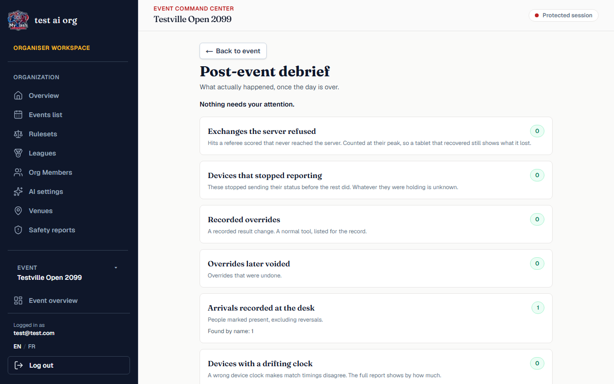

**Ce que vous allez apprendre :** ce que montre le débriefing, et comment recueillir l'avis des gens
sur votre événement.

## L'ouvrir

Ouvrez **Débriefing** dans le menu de l'événement. Il faut le rôle **Teneur de score** ou un rôle
au-dessus. Vous pouvez l'ouvrir à tout moment, pas seulement après l'événement.

Le titre dit **Rien ne requiert votre attention.** ou **Certains points méritent un coup d'œil.**

## Les six cartes

Chaque carte montre un nombre, toujours, même à zéro.

| Carte                                 | Ce qu'elle compte                                                                                                                                                        | À regarder quand         |
| ------------------------------------- | ------------------------------------------------------------------------------------------------------------------------------------------------------------------------ | ------------------------ |
| **Échanges refusés par le serveur**   | Les touches marquées sur une tablette qui ne sont jamais arrivées au serveur, comptées au plus haut : une tablette qui s'est rétablie montre toujours ce qu'elle a perdu | Il y en a                |
| **Appareils ayant cessé de répondre** | Les tablettes qui se sont tues plus de 10 minutes avant la dernière. Ce qu'elles retenaient est inconnu                                                                  | Il y en a                |
| **Corrections enregistrées**          | Les résultats changés à la main, par raison                                                                                                                              | Jamais : un outil normal |
| **Corrections annulées**              | Les corrections qui ont été défaites                                                                                                                                     | Jamais                   |
| **Arrivées enregistrées à l'accueil** | Les personnes marquées présentes, trouvées par le nom ou par le pass scanné                                                                                              | Jamais                   |
| **Appareils dont l'horloge dérive**   | Les comptes de tablette dont l'horloge a 30 secondes d'écart ou plus                                                                                                     | Il y en a                |

**Ouvrir le rapport d'horloge complet** montre les horloges en détail.

Une tablette éteinte tôt dans la journée apparaît sous **Appareils ayant cessé de répondre** :
vérifiez qu'elle a seulement été éteinte.

## Ce que les gens ont dit

Le panneau **Ce que les gens ont dit** montre la note moyenne sur 5, le nombre de réponses, une
ligne par rôle (combattants, arbitres, instructeurs, participants) et les commentaires.

- Un rôle qui a moins de 3 réponses n'a pas sa propre ligne.
- Un commentaire est anonyme, sauf si la personne a coché **Signer cet avis : l'organisateur verra
  votre nom.**
- Une réponse donnée de nouveau remplace la première.

**MyClash ne demande pas l'avis des gens.** Partagez le formulaire vous-même : son adresse est la
page publique de votre événement suivie de `/feedback`, par exemple
`app.myclash.fr/e/votre-evenement/feedback`. Tout le monde peut répondre, avec un compte ou en
invité sur son téléphone.
