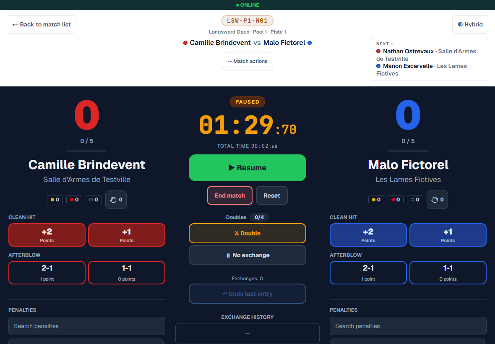
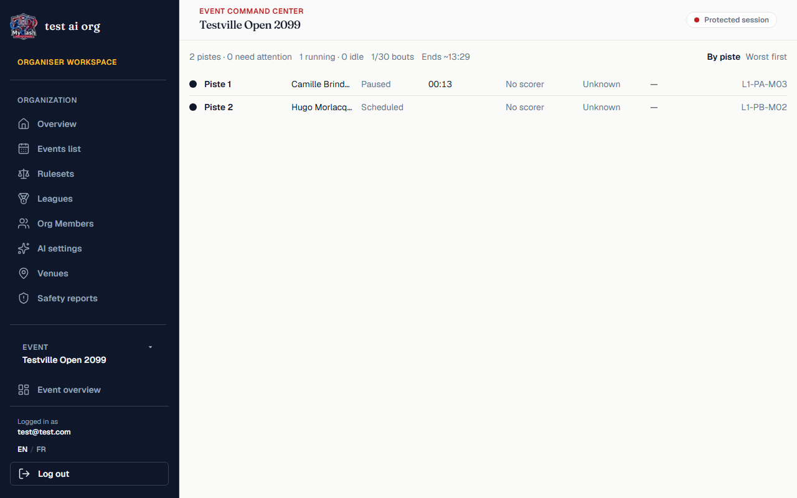

**Ce que vous allez faire :** vérifier que tout est prêt, connecter les tablettes, marquer les
combats, et suivre toutes les lices depuis un seul écran.

## Avant le premier combat

Sur votre événement, ouvrez **Début de journée**. La page vérifie quatre choses dans l'ordre :
l'événement existe, la liste des inscrits est fiable, le tirage existe, et tout est prêt pour
lancer. Chaque ligne dit **OK** ou combien de choses restent à faire, avec un lien vers l'écran
qui les règle.

## Connecter les tablettes

Sur chaque tablette, ouvrez le lien de connexion de **Staff événement** (ou scannez son QR code).
Saisissez l'**Identifiant** et le **PIN** du compte, puis touchez **Connexion PIN**. La tablette
affiche les combats des lices affectées à ce compte.

Avant l'événement, essayez **S'entraîner hors ligne** sur la liste des lices : un exercice de
deux minutes qui montre au marqueur la tablette sans wifi.

## Marquer un combat

- **Démarrer** lance le chrono ; **Pause** l'arrête ; **Reprendre** le relance.
- Chaque combattant a des boutons **Touche propre** (+2, +1) et **Contre-frappe** (2-1, 1-1),
  tels que le règlement du tournoi les définit.
- **Double** enregistre une double touche, **Aucun échange** un échange sans touche valable.
- **Annuler la dernière saisie** revient sur la dernière saisie.
- **Pénalités** : cherchez dans la liste des pénalités et donnez un carton.
- **Terminer le match** quand le combat est fini. **Actions du match** ouvre les corrections.

Le score affiché est calculé par MyClash à partir des échanges saisis, avec le règlement du
tournoi.

## Quand le wifi tombe

La barre en haut de la tablette affiche **EN LIGNE** en vert. Quand le réseau tombe, elle devient
grise et indique que les échanges sont en attente sur la tablette. Continuez à marquer : les
touches, les cartons et le chrono sont gardés sur la tablette et envoyés dès que le réseau
revient. Seules les corrections (dans **Actions du match**) ont besoin du réseau.

## Suivre toutes les lices

Ouvrez **En direct**. Une ligne par lice : qui combat, l'état du combat, si la tablette est
synchronisée. **Problèmes en premier** met en haut les lices qui ont besoin de vous. Cliquez sur
une lice pour lui affecter un autre marqueur.

<aside class="guide-warn">
  
<strong>Difficile à annuler.</strong> Rouvrir un combat terminé demande le réseau. Sans wifi,
  un combat terminé le reste jusqu'au retour du réseau : vérifiez le score avant
  <strong>Terminer le match</strong>.

</aside>
