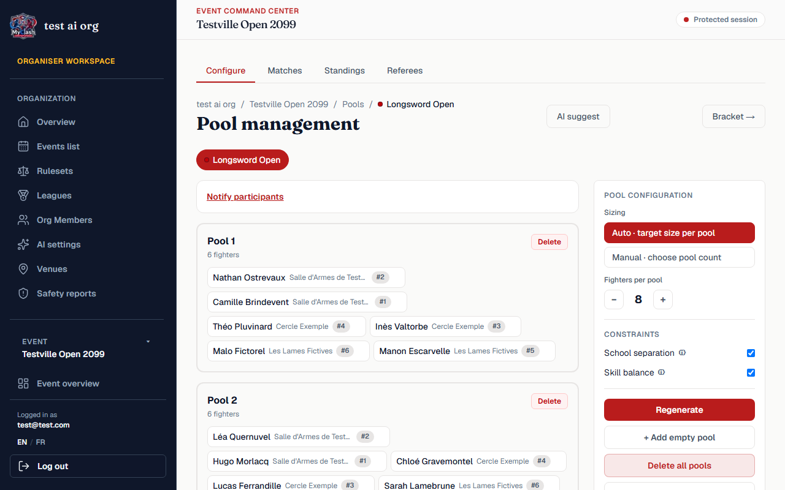
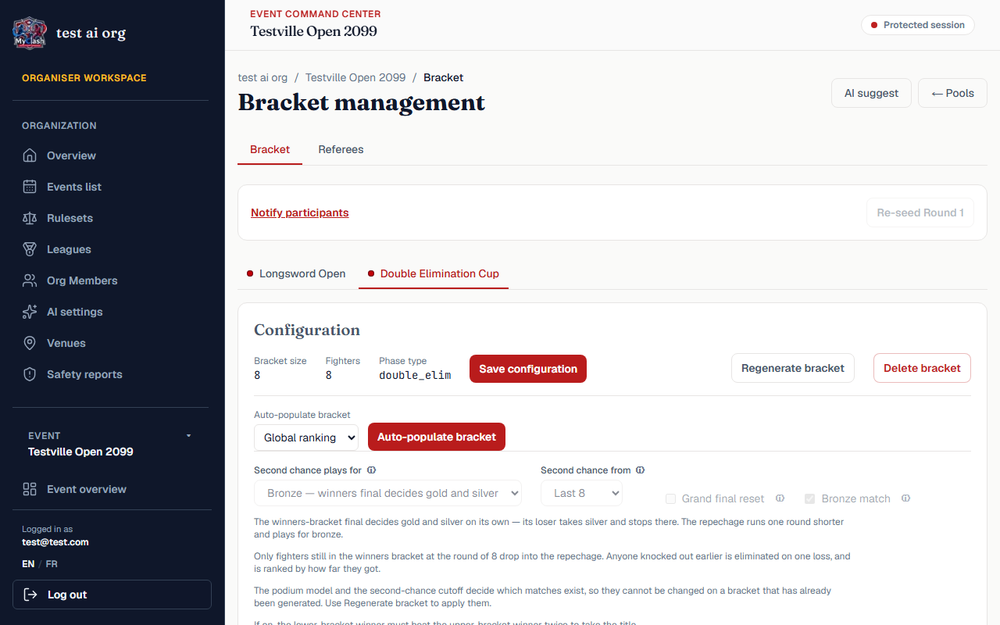
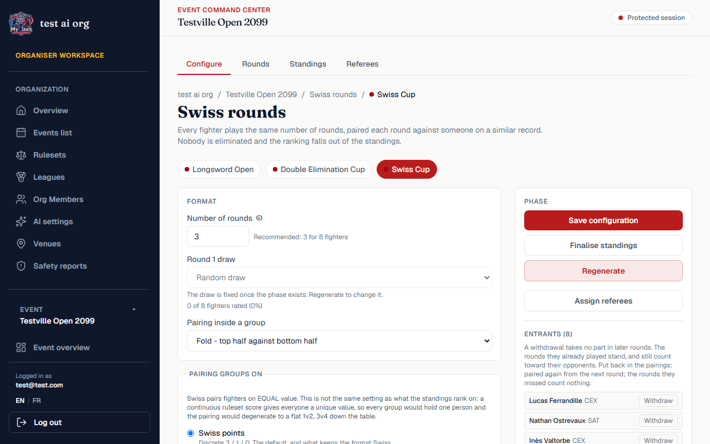

**Ce que vous allez apprendre :** les quatre formats que MyClash fait tourner, les réglages qui
les changent, et lequel choisir.

Un tournoi est fait de **phases**. La forme habituelle : des poules, puis un tableau. Vous pouvez
aussi ne faire que des poules, que un tableau, ou des rondes suisses.

## Les poules

Chaque combattant d'une poule rencontre une fois chacun des autres.

- **Le tirage** : MyClash répartit les têtes de série dans les poules, puis améliore le tirage.
  Avec **Séparation par club**, il sépare les combattants d'un même club ; avec
  **Équilibrage du niveau**, il répartit les plus forts.
- **Le classement** d'une poule suit le règlement. Avec TF_v1 : d'abord le score de poule, puis
  les victoires, puis le moins de doubles, puis le moins de touches reçues. Avec le règlement à
  limite de points : les victoires, puis la différence de points, puis les points marqués.

## L'élimination directe

Le perdant d'un combat est éliminé. Le vainqueur passe seul au tour suivant.

- **Format** : **Élimination directe**, avec **Nombre de qualifiés (top N des poules)**.
- Quand le nombre de combattants n'est pas une puissance de deux, MyClash garde la plus grande
  puissance de deux qui tient, et les combattants en trop jouent d'abord un tour court (un tour
  préliminaire). Réglez **Taille du tableau forcée (puissance de 2, max …)** si vous préférez des
  exemptions.
- Un tableau de 4 combattants ou plus a toujours un match pour le bronze.

## La double élimination

Un combattant doit perdre deux fois pour être éliminé. Une première défaite l'envoie dans le
tableau des repêchages.

- **La seconde chance joue pour** :
  - **L’or — repêchages puis grande finale** : le survivant des repêchages rencontre le vainqueur
    du tableau principal en grande finale. Avec **Grande finale avec reset**, le combattant des
    repêchages doit gagner cette finale deux fois. La troisième place va au perdant de la finale
    des repêchages.
  - **Le bronze — la finale principale décide or et argent** : la finale du tableau principal
    décide seule l'or et l'argent, et les repêchages jouent pour le bronze. **Match pour le
    bronze** décide la troisième place ; sans lui, les deux derniers des repêchages sont classés
    3e et 4e au score de poule.
- **Seconde chance à partir de** : **Tout le monde**, ou seulement ceux encore dans le tableau
  principal à une profondeur donnée (**Les … derniers**). Les éliminés plus tôt sont sortis dès la
  première défaite.
- Pas d'exemption : les combattants en trop jouent un tour préliminaire, et ses perdants sont
  éliminés tout de suite. Un tableau à double élimination compte 128 combattants au plus.
- Une fois généré, seul **Grande finale avec reset** se modifie encore. Pour le reste, cliquez
  sur **Régénérer le tableau**.

## Les rondes suisses

Chaque combattant joue le même nombre de rondes, chaque fois contre quelqu'un au bilan proche.
Personne n'est éliminé ; le classement sort des résultats.

- **Nombre de rondes** : de 3 à 9.
- **Tirage de la ronde 1** : au hasard, selon le classement, ou selon le rang de poule (il faut
  alors une phase de poules terminée).
- **Appariement au sein d'un groupe** : **Plié - moitié haute contre moitié basse** ou
  **Adjacent - 1c2, 3c4**. MyClash évite les revanches et donne une exemption au combattant le
  moins bien classé qui n'en a pas encore eu.
- Les points : une victoire vaut 3, un nul 1, une défaite 0, une exemption 3. Les égalités se
  départagent au Buchholz, puis au Sonneborn-Berger, puis selon l'ordre du règlement.
- La ronde suivante s'apparie seule quand le dernier combat de la ronde se termine.

## Des poules au tableau

**Remplir le tableau** remplit le premier tour à partir du classement des poules :
**Classement général** (les meilleurs de toutes les poules) ou **Top-N par poule** (les N premiers
de chaque poule). Quand le dernier combat de poule se termine, MyClash remplit seul un tableau
déjà généré.

## Lequel choisir

- _Une soirée club ou une courte soirée_ : des poules seules, ou des rondes suisses. Tout le
  monde combat plusieurs fois, et personne n'attend longtemps.
- _Un open classique_ : des poules, puis une élimination directe.
- _Vous voulez qu'une défaite soit pardonnée_ : la double élimination, idéalement avec la seconde
  chance pour le bronze, pour garder une journée courte.
