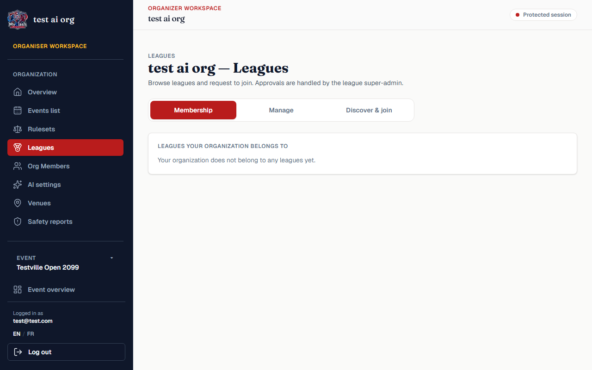

**Ce que vous allez apprendre :** ce qu'est une ligue, comment votre club en rejoint une, comment
vos tournois y comptent, et quand son classement change.

## Ce qu'est une ligue

Une ligue classe les combattants, et les clubs, sur plusieurs événements d'une saison. Chaque
tournoi de la ligue donne à ses combattants des points selon leur place finale. Le barème de la
ligue dit combien.

Seule l'équipe MyClash crée une ligue. Votre club en rejoint une, ou en gère une quand la ligue le
nomme administrateur.

Ce qui compte :

- Seulement les événements **Standard**. Un événement de Test ou de Club ne compte jamais (voir
  [Avant de commencer](/guide/before-you-start)).
- Seulement les tournois publiés, et seulement les combattants qui ont une place finale.
- Rien ne change dans une saison clôturée.

## Rejoindre une ligue

Ouvrez **Ligues** dans le menu de votre organisation. Il y a trois onglets : **Adhésion**,
**Gérer** et **Découvrir et rejoindre**.

Dans **Découvrir et rejoindre**, cliquez sur **Demander à rejoindre**, avec un message si vous le
voulez. Il faut le rôle **Administrateur**. Un administrateur de la ligue accepte ou refuse.

## Rattacher un tournoi

Chaque tournoi rejoint une ligue seul. Il faut le rôle **Administrateur**.

- Depuis la page **Tournois** de l'événement : cliquez sur **Demander le rattachement à une
  ligue**, choisissez la **Ligue** et le **Tournoi**, puis **Envoyer la demande**.
- Ou depuis **Ligues** : ouvrez **Rattacher un tournoi**, choisissez, puis **Rattacher**.

Un administrateur de la ligue accepte ou refuse la demande. Quand elle est acceptée, votre club
devient aussi membre de la ligue.

**Retirer** annule une demande. **Quitter** sort de la ligue un tournoi accepté : ses points
quittent le classement aussitôt. Dans une saison clôturée, ils le quittent quand la saison est
rouverte.

## Gérer une ligue

Quand votre club administre une ligue, **Gérer →** l'ouvre. Les onglets sont **Informations**,
**Barème**, **Groupes**, **Tournois**, **Demandes** et **Administrateurs**.

- **Informations :** le nom, la description et le **Statut** : Brouillon, Publié ou Archivé.
  Seule une ligue publiée est publique. Une ligue archivée est cachée aussi.
- **Barème :** le **Système de pointage** et la **Dimension de classement** : **Arme uniquement**
  (un classement par arme), **Arme + groupe** (un classement par arme et par groupe) ou **Groupe
  uniquement**. Les points personnalisés sont réglés par l'équipe MyClash.
- **Groupes :** **Ajouter un groupe**, par exemple un par division. Quand une ligue a plusieurs
  groupes, chaque tournoi doit nommer son groupe.
- **Demandes :** les tournois et les clubs qui attendent une réponse : **Accepter** ou
  **Refuser**.
- **Administrateurs :** les personnes et les clubs qui gèrent la ligue. Une ligue en garde
  toujours au moins un.

## Quand le classement change

Le classement ne change **pas** quand un combat se termine. MyClash le recalcule quand :

1. un événement est terminé ;
2. un événement passe de Standard à Test ou Club, ou l'inverse ;
3. une touche ou un carton d'un événement terminé est corrigé (sur un événement terminé, une
   correction que vous demandez attend d'abord une validation) ;
4. un tournoi quitte la ligue.

L'équipe MyClash peut aussi recalculer une ligue à la main. Rouvrir une saison clôturée ne la
recalcule pas.

## Ce que voit le public

Une ligue publiée a sa propre page sur app.myclash.fr : le classement des combattants, le
**Classement des clubs**, les événements de la ligue, un CSV et un rapport imprimable. Les
tournois d'un événement en brouillon ou de Test restent cachés.
