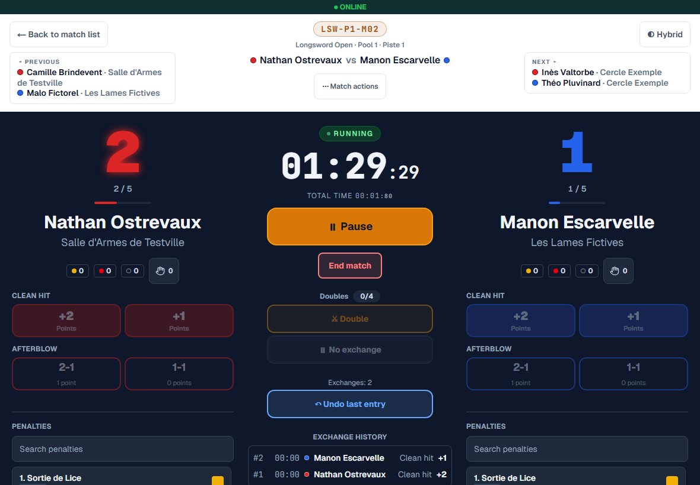
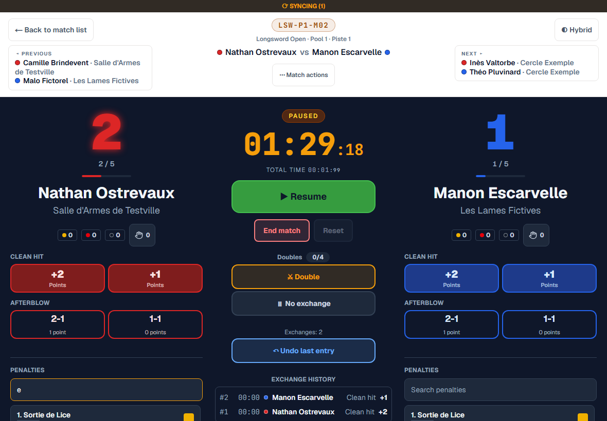
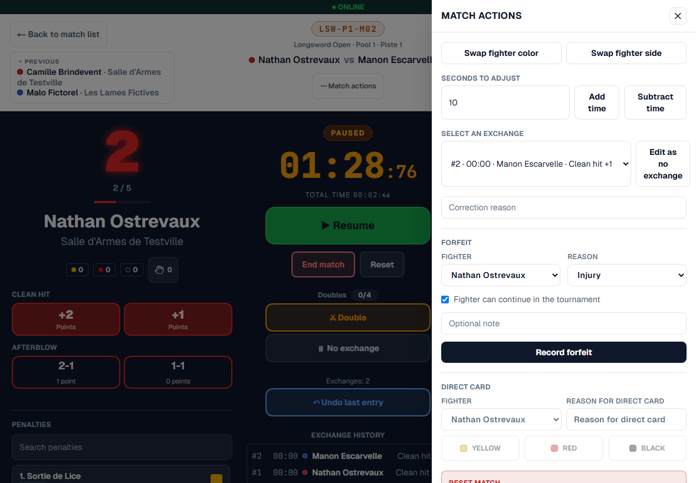
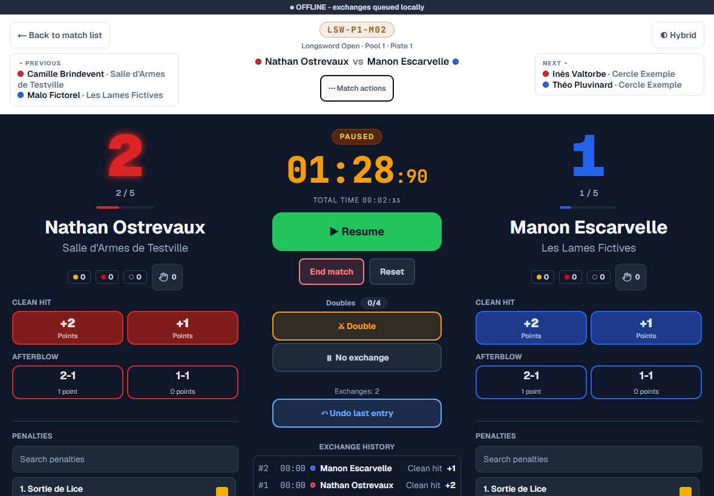
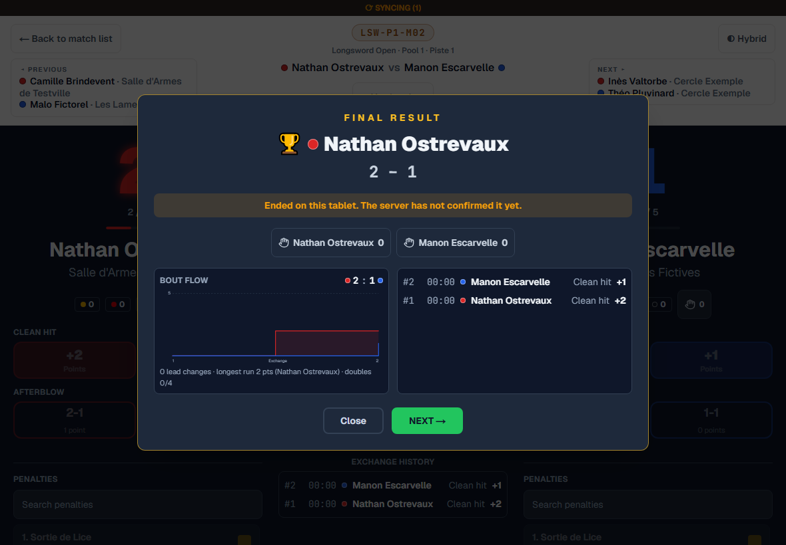

**Ce que vous allez apprendre :** chaque commande de la tablette de score, dans quel état du
combat elle marche, et que faire quand quelque chose se passe mal. Pour former un bénévole,
commencez par la [Fiche du marqueur](/guide/scorekeeper-sheet).

## Se connecter

- Le lien **Connexion staff** de votre événement ouvre le formulaire avec l'événement déjà rempli.
  Le lien propre à un compte remplit aussi son **Identifiant** : le bénévole ne saisit que le
  **PIN**.
- Sans le lien, la tablette affiche une liste d'événements où choisir.
- Un organisateur peut se connecter avec son propre compte (le formulaire par e-mail, sous celui
  du PIN) : avec le rôle **Teneur de score** ou plus, il marque n'importe quelle lice, sans PIN.
- **Vos lices** liste les lices du compte. **S'entraîner hors ligne**, sur cette page, lance un
  exercice de deux minutes sans réseau ; il est refusé tant que la tablette a encore quelque chose
  à envoyer.
- La page d'une lice montre le combat en cours, les cinq prochains combats, puis tous les combats
  de la lice.

## L'écran du combat

En haut : **Retour à la liste des assauts**, le combat précédent et le suivant de la lice, le code
du combat, le tournoi, la phase et la lice, les deux combattants, leur contrôle du matériel, et
**Actions du match**. Le bouton de thème passe de Hybride à Sombre puis à Clair.

**Appeler** prévient les organisateurs : choisissez **Médecin**, **Arbitre principal** ou
**Litige**, et la ligne de la lice dans leur salle de contrôle indique **À traiter** jusqu'à ce
que l'un d'eux y réponde. L'appel demande le réseau et n'est jamais gardé pour plus tard : s'il
dit « Non envoyé : pas de réseau. Appelez de vive voix ou par téléphone. », faites-le.

## Ce qui marche dans quel état

| Commande                                                            | Pas commencé             | Chrono en cours | En pause                                                           | Terminé                                  |
| ------------------------------------------------------------------- | ------------------------ | --------------- | ------------------------------------------------------------------ | ---------------------------------------- |
| Bouton principal du chrono                                          | **Démarrer**             | **Pause**       | **Reprendre**                                                      | **Rouvrir le match** (demande le réseau) |
| **Terminer le match** (ou **Terminer la manche**)                   | —                        | oui             | oui                                                                | —                                        |
| **Réinitialiser** (le chrono seulement, demande d'abord)            | —                        | —               | oui, jusqu'à la prolongation ou la mort subite (demande le réseau) | —                                        |
| **Touche propre**, **Contre-frappe**, **Double**, **Aucun échange** | éteints                  | _éteints_       | oui                                                                | éteints                                  |
| Pénalités                                                           | éteintes                 | oui             | oui                                                                | éteintes                                 |
| Réclamations                                                        | éteintes                 | oui             | oui                                                                | oui                                      |
| **Annuler la dernière saisie**                                      | dès qu'une saisie existe |                 |                                                                    |                                          |

Les boutons d'échange sont éteints pendant que le chrono tourne : l'arbitre arrête, le marqueur
met en pause, saisit l'échange, et reprend.

_Les touches du clavier :_ la barre d'espace démarre et met en pause le chrono (elle ne rouvre
jamais un combat), D saisit un double, U annule la dernière saisie. Elles ne font rien quand une
fenêtre est ouverte ou qu'on écrit dans un champ.

## Marquer

- Les boutons **Touche propre** et **Contre-frappe** viennent du règlement du tournoi : leurs
  libellés et leurs valeurs sont ceux du règlement.
- En poules et en rondes suisses, **Double** compte pour la limite affichée **Doubles** x/max. À la
  limite, le combat se termine comme le disent les réglages du tournoi : double défaite, nul, ou le
  score reste.
- **Aucun échange** demande la raison : **Sortie de lice**, **Arrêt simultané**,
  **Pas de touche valide** ou une autre.
- Sous chaque combattant : le score, et le score face à la limite de points. À la limite, le score
  passe en or. Tant que des échanges attendent d'être envoyés, la tablette dit combien.
- _Avec le réseau, le combat se termine seul quand une touche atteint la limite de points_ : les
  boutons s'éteignent et le résultat s'affiche. Sans réseau, touchez **Terminer le match** à la
  limite. Terminer avant la limite ou la fin du temps demande d'abord une confirmation.

## Pénalités et réclamations

- Chaque combattant a des boutons rapides pour les pénalités habituelles du tournoi, et une
  recherche pour les autres.
- La tablette affiche le carton que le combattant recevra vraiment : dans un groupe du règlement
  de pénalités, chaque récidive vaut le carton suivant. Un carton jaune est donné tout de suite ; un
  rouge ou un noir demande d'abord (**Donner le carton**). Avec le règlement FFAMHE intégré, le
  rouge coûte un point et le noir fait perdre le combat.
- Le bouton en forme de main enregistre une réclamation, sans question. Quand un combattant
  dépasse la limite de réclamations du tournoi, la tablette propose la pénalité choisie dans les
  paramètres (**Donner le carton**).

## Actions du match

**Actions du match** ouvre les corrections :

- **Inverser les couleurs** et **Inverser les côtés** ;
- **Ajouter du temps** et **Retirer du temps** ;
- choisir un échange, puis **Corriger en aucun échange** pour l'annuler (avec une
  **Raison de correction**) ;
- le forfait : le combattant, la raison, et s'il peut continuer le tournoi, puis
  **Enregistrer le forfait** (pendant que le combat tourne ou est en pause) ;
- **Carton direct** : un carton hors de la liste des pénalités, avec sa raison ;
- **Réinitialiser le match** : efface le combat ; tapez RESET MATCH pour confirmer.

Tout ce qui est dans **Actions du match** demande le réseau, sauf le carton direct.

## Manches, prolongation et mort subite

- Dans un combat en plusieurs manches, l'en-tête affiche la manche, **Terminer le match** devient
  **Terminer la manche**, et un écran de pause propose de lancer la manche suivante.
- Quand les scores sont à égalité à la fin du temps, la tablette propose l'étape suivante que
  définit le tournoi : la prolongation ou la **Mort subite** (le combat se termine alors dès qu'un
  combattant mène). La tablette refuse de terminer un combat à égalité qui doit être départagé.
- Reprendre une fois le temps écoulé demande d'abord : fermer, terminer le combat, ou continuer
  quand même.

## Sans wifi

| La barre dit                                | Ce que ça veut dire                                                                                                               |
| ------------------------------------------- | --------------------------------------------------------------------------------------------------------------------------------- |
| **EN LIGNE**                                | Tout est envoyé.                                                                                                                  |
| **SYNCHRONISATION**                         | Des saisies sont en cours d'envoi.                                                                                                |
| **HORS LIGNE - échanges en attente locale** | Pas de réseau : continuez, la tablette garde tout.                                                                                |
| **ERREUR DE SYNCHRO**                       | L'envoi a échoué : **Réessayer**.                                                                                                 |
| Touches non enregistrées, **Examiner**      | Le serveur a refusé une saisie : ouvrez **Examiner** pour la renvoyer ou l'abandonner. En attendant, le reste du combat patiente. |

- _En attente sans réseau :_ les touches, les cartons, les réclamations, le chrono (démarrer,
  pause, reprendre, terminer), les manches et la prolongation.
- _Demande le réseau :_ **Rouvrir le match**, **Réinitialiser** le chrono, déverrouiller un
  combat, les forfaits, et tout ce qui est dans **Actions du match** sauf le carton direct.
- Un combat terminé hors ligne indique qu'il a été terminé sur la tablette et que le serveur ne
  l'a pas encore confirmé. Il ne peut pas être rouvert avant le retour du réseau.

### Comment la tablette garde vos saisies

- Chaque appui est d'abord enregistré sur la tablette, puis envoyé. Si la tablette ne peut pas
  l'enregistrer, elle dit « Non enregistré sur cette tablette. Appuyez de nouveau. »
- Les saisies restent dans le stockage du navigateur : recharger la page ou se déconnecter les
  garde. Après une reconnexion, elles partent dès qu'un combat est ouvert, et la page de
  connexion dit combien attendent.
- Elles appartiennent à ce navigateur. Une fenêtre privée ou un autre navigateur sur la même
  tablette a sa propre file, et effacer les données du navigateur supprime les saisies pas encore
  envoyées.
- La tablette demande au navigateur de garder ce stockage, pour qu'une tablette à court de place
  ne l'efface pas d'elle-même.

### Ouvrir la tablette sans réseau

- Une fois la tablette ouverte avec le réseau, elle garde l'application : ses pages s'ouvrent sans
  réseau, page d'un combat comprise. Une page que la tablette n'a pas gardée ouvre la page
  d'accueil à la place, ou, si même celle-ci manque, une page qui dit « Vous êtes hors ligne »
  avec **Réessayer**.
- La tablette garde aussi une copie de sa lice : les combats, leurs scores et chronos, et les
  règles du tournoi. Elle rafraîchit cette copie toutes les 5 minutes tant qu'un écran de la lice
  est ouvert.
- Sans réseau, un combat s'ouvre depuis cette copie et le dit : « Pas de connexion. Voici l'assaut
  tel que cette tablette l'a lu… ». Le score indique **non confirmé**.
- Un combat marqué sur une autre tablette n'est pas dans la copie : « Cet assaut n'est pas encore
  chargé. Il s'ouvrira au retour du réseau. »
- Avant l'événement, ouvrez la liste de la lice sur chaque tablette avec le réseau, puis faites
  une fois **S'entraîner hors ligne**.

### Comment les saisies partent

- Dans l'ordre des appuis. La tablette envoie après chaque appui, à l'ouverture d'un combat ou de
  la liste de la lice, au retour du réseau, et toutes les 5 secondes tant que la barre dit
  **HORS LIGNE** et que le wifi est encore là.
- Une saisie envoyée deux fois ne compte qu'une fois : chacune porte sa propre identité.
- Sur **ERREUR DE SYNCHRO**, la tablette ne réessaie pas seule : appuyez sur **Réessayer**.
- Une saisie que le serveur refuse passe dans **Examiner**. Elle y est gardée, jamais supprimée :
  **Réessayer** une fois la cause réglée, ou abandonnez-la si vous l'avez déjà ressaisie à la main.
  Les saisies de ce combat attendent derrière elle ; les autres combats continuent.
- Quand la session prend fin, la barre dit **SESSION TERMINÉE** : reconnectez-vous, et la file
  part.

### Le score sur la tablette et le score qui compte

- Sans réseau, la tablette affiche le dernier score du serveur plus les saisies qu'elle garde,
  calculés avec le règlement du tournoi. Le score indique alors « dont … non envoyés ».
- Une fois les saisies envoyées, la tablette relit le combat et le score du serveur remplace le
  sien. C'est le score du serveur qui compte.

### Comment la tablette reçoit les nouvelles

La tablette ne reçoit pas de mises à jour en direct ; elle relit :

- la liste de la lice toutes les 20 secondes, et au retour du réseau ;
- le combat après chaque envoi, et au retour du réseau.

Un changement fait ailleurs (une autre tablette, un organisateur, un planning déplacé) apparaît
donc à la lecture suivante. Quand l'organisateur change les règles d'un combat, la tablette dit
« L'organisateur a changé les règles de cet assaut. » Une nouvelle version de la tablette
s'installe seule à la prochaine page ouverte avec le réseau, sans rien demander.

### Le chrono sans réseau

- Le chrono continue de tourner sur la tablette, et démarrer, pause, reprendre et terminer sont
  mis en file comme les touches.
- Une tablette dont la date ou l'heure est fausse chronomètre quand même juste : le serveur
  utilise depuis combien de temps chaque appui a été fait, pas l'horloge de la tablette. Un appui
  vieux de plus d'un jour est refusé.

### Ce que voient les autres écrans

- La page publique d'un combat, les écrans en direct et ceux de la salle ne montrent que ce qui a
  atteint le serveur. Les saisies encore sur une tablette apparaissent dès qu'elles partent.
- La salle de contrôle de l'organisateur montre la file de chaque tablette et combien de ses
  saisies le serveur a refusées (elles attendent dans **Examiner**), avec **Sync en retard** quand
  une saisie attend plus d'une minute, **Sync bloquée** au-delà de cinq minutes.
- Une tablette donne des nouvelles toutes les 20 secondes tant qu'elle a le réseau. Avec un combat
  sur sa lice et aucune nouvelle depuis une minute, sa ligne passe à l'orange et dit « Pas de
  nouvelles depuis 2 min » ; après cinq minutes elle passe au rouge. Sa ligne « Vu il y a… » dit
  quand elle a donné des nouvelles pour la dernière fois.
- Rien n'empêche deux tablettes de marquer la même lice. Gardez une tablette par lice : un appui
  sur le chrono qui croise celui de l'autre tablette passe dans **Examiner**.

## Verrous et qui peut revenir en arrière

- Une poule ou un tableau terminé se verrouille seul 15 minutes après son dernier combat (réglage
  **Verrouillage auto** du tournoi). Un combat verrouillé affiche un bandeau et refuse le score et
  les corrections.
- Un organisateur (**Éditeur** ou plus) peut toujours rouvrir un combat verrouillé. Un compte de
  tablette ne le peut que si le verrouillage auto du tournoi est désactivé.
- Un compte de tablette ne marque que les lices qui lui sont affectées.

