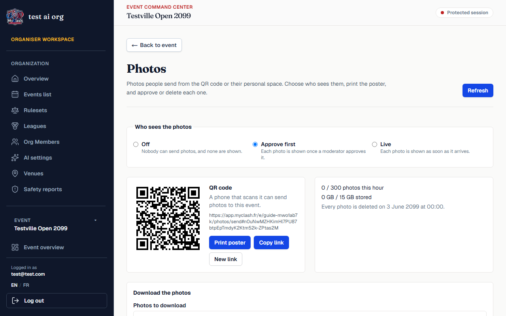

**Ce que vous allez apprendre :** comment les gens envoient des photos à votre événement, comment
vous les vérifiez, et ce que voit le public.

## Les activer

Ouvrez **Photos** dans le menu de l'événement (il faut le rôle **Administrateur**). Sous **Qui voit
les photos** :

| Choix                 | Ce qui se passe                                                              |
| --------------------- | ---------------------------------------------------------------------------- |
| **Désactivé**         | Personne ne peut envoyer de photo, et aucune n'est affichée. C'est le départ |
| **Approuver d'abord** | Chaque photo est affichée une fois approuvée par un modérateur               |
| **En direct**         | Chaque photo est affichée dès son arrivée                                    |

Une photo garde l'état avec lequel elle est arrivée. Une photo envoyée sous **Approuver d'abord**
attend toujours après le passage à **En direct**. Passer à **Désactivé** ne supprime rien.

## Qui peut envoyer

- **Toute personne qui a le QR code**, sans compte. Le nom, la légende et l'étiquette (un tournoi ou
  un atelier) sont facultatifs. **Imprimer l'affiche** imprime le QR code ; **Copier le lien** copie
  son lien. **Nouveau lien** remplace le QR code : chaque affiche déjà imprimée ne marche plus.
- **Une personne qui a un compte**, depuis son espace personnel, pour un événement de sa liste. Sa
  photo porte son nom.

L'envoi est ouvert de 0 h la veille de l'événement jusqu'à la fin du lendemain, à l'heure de
l'événement. Pour un événement en brouillon ou de Test, un téléphone sans compte de membre ne peut
pas ouvrir la page d'envoi.

Sur un téléphone, **Prendre une photo** ouvre l'appareil photo et **Choisir des photos** ouvre la
galerie. Sur un ordinateur, seul **Choisir des photos** est affiché.

**Les règles d'une photo :** JPEG seulement, jusqu'à 12 Mo. Une photo d'iPhone en HEIC est refusée,
avec le conseil de régler l'appareil photo sur « Le plus compatible ». Une photo de l'appareil photo
est envoyée telle quelle. Une image enregistrée depuis un site web ou exportée d'une application est
d'abord réenregistrée par le téléphone, en JPEG standard, puis envoyée.
Chaque téléphone, et chaque compte, peut envoyer 20 photos par heure. L'événement entier reçoit au
plus 300 photos par heure et 15 Go en tout : la page Photos affiche les deux nombres. Les données de
lieu d'une photo sont retirées.

## Les vérifier

Trois endroits peuvent approuver et supprimer :

- la page **Photos** de l'événement (un **Administrateur**) ;
- un compte de tablette **Photos** (voir [Les accès](/guide/staff-access)), jusqu'à l'archivage de
  l'événement ;
- l'équipe MyClash.

Les onglets sont **En attente**, **Signalées** et **Toutes**. **Approuver** affiche une photo en
attente. **Supprimer** retire une photo pour de bon : il n'y a pas de « refuser », Supprimer est le
refus. **Conserver** répond aux signalements d'une photo signalée et la laisse affichée.

**Personne n'est prévenu** d'une photo nouvelle ou signalée : regardez les nombres dans les onglets.

## Ce que voit le public

Avec **En direct** ou **Approuver d'abord**, la page de l'événement montre une carte **Photos** qui
ouvre les photos approuvées, les plus récentes d'abord, avec leur nom, leur légende et leur
étiquette. Les moteurs de recherche ne listent pas cette page.

Chacun peut **Signaler** une photo, avec un commentaire facultatif. La photo reste affichée jusqu'à
la décision d'un modérateur.

**Une personne sur une photo qui veut la faire retirer** la signale avec un commentaire, ou vous le
demande. Une personne qui a envoyé une photo depuis son espace personnel peut l'y supprimer à tout
moment. Une photo envoyée avec le QR code ne peut être supprimée que par un modérateur.

## Combien de temps elles restent

Chaque photo, avec ses signalements, est supprimée le 31e jour après le dernier jour de
l'événement. La page Photos affiche la date. Déplacer la date de fin la déplace aussi. D'ici là, un
événement archivé montre toujours ses photos, reçoit des signalements et peut être modéré.

**Télécharger le zip** (un **Administrateur**) télécharge les photos en attente et approuvées, avec
leur liste.
