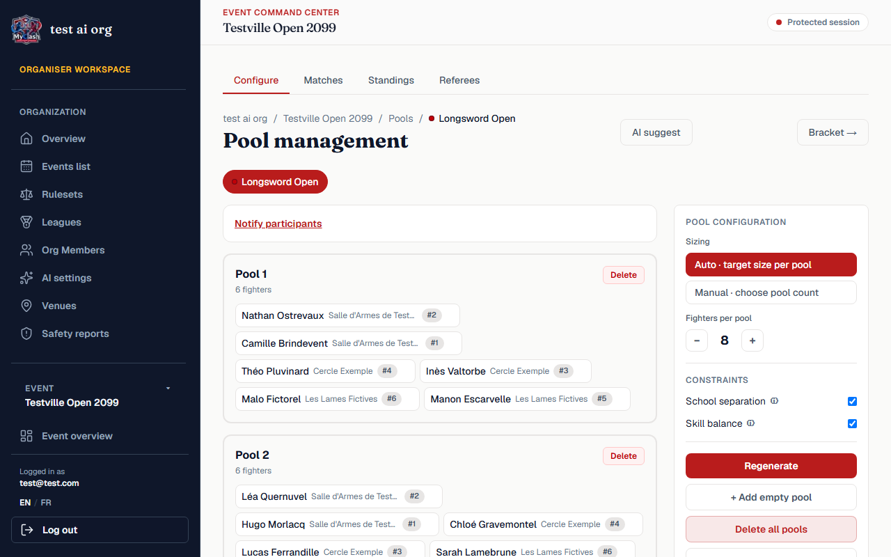

**Ce que vous allez faire :** répartir les combattants d'un tournoi en poules, les ajuster à la
main, et les rendre publiques.

## Générer les poules

1. Sur votre événement, ouvrez **Poules**. La page s'appelle **Gestion des poules**. Choisissez
   votre tournoi parmi les pastilles de couleur en haut.
2. Choisissez comment dimensionner les poules :
   - **Auto · taille cible par poule** : vous réglez **Combattants par poule** (8 au départ), et
     MyClash en déduit le nombre de poules.
   - **Manuel · choisir le nombre de poules** : vous réglez vous-même le **Nombre de poules**.
3. Sous **Contraintes**, laissez **Séparation par club** activée pour séparer les combattants
   d'un même club, et **Équilibrage du niveau** pour répartir les meilleurs entre les poules.
4. Cliquez sur **Générer les poules**.

La page ouvre ensuite l'onglet **Matchs** : tous les combats de toutes les poules.
**Classements** montre le classement de chaque poule au fil des combats.

## Ajuster à la main

- Faites glisser un combattant sur une autre poule pour le déplacer, ou sur la liste des non
  affectés pour le retirer.
- **+ Ajouter une poule vide** ajoute une poule que vous remplissez à la main.
- **Régénérer** refait le tirage.

## Montrer les poules aux combattants

Il n'y a pas d'interrupteur à part pour les poules. Les combattants les voient dès que le
**tournoi** est public (et l'événement aussi). **Notifier les participants** ouvre un message aux
combattants, déjà rempli avec « les poules sont prêtes ».

<aside class="guide-warn">
  
<strong>Difficile à annuler.</strong> <strong>Régénérer</strong> et
  <strong>Supprimer toutes les poules</strong> suppriment les poules et tous leurs combats. Dès
  qu'un combat a été marqué, une poule ne se modifie plus : déplacer un combattant, la renommer ou
  la supprimer est refusé. Seul le propriétaire de l'organisation peut alors effacer des combats
  marqués. Vérifiez les poules avant le premier combat.

</aside>
