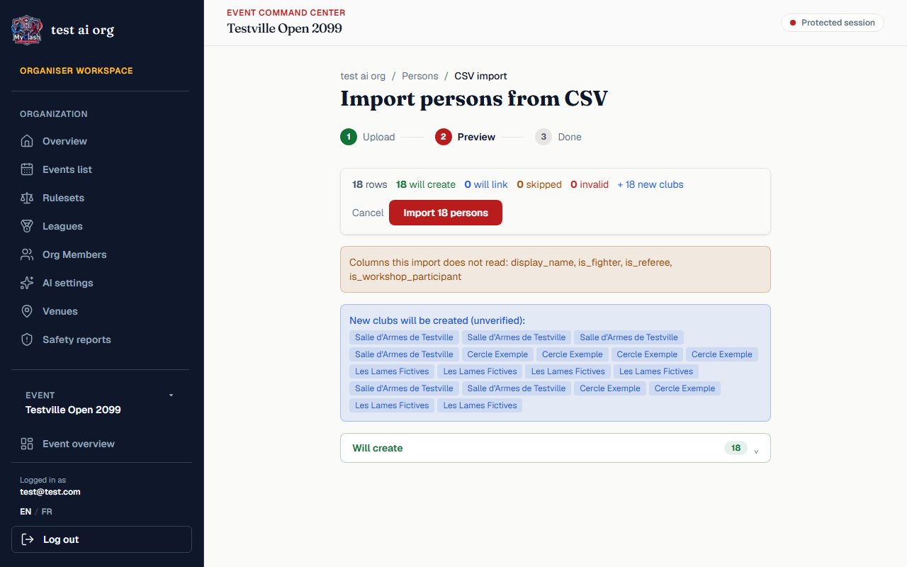
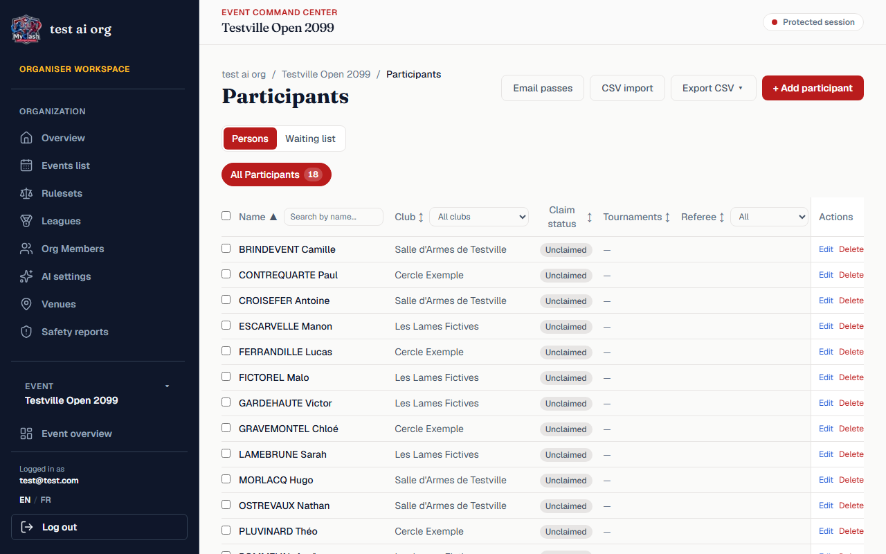

**Ce que vous allez faire :** mettre vos combattants sur la liste de l'événement, puis les
inscrire à un tournoi.

Deux étapes distinctes : d'abord une personne rejoint la **liste de l'événement** (la page
**Participants**), ensuite vous l'**inscrivez à un tournoi**. Un import CSV ne fait que la
première étape.

## Un par un

1. Sur votre événement, ouvrez **Participants** et cliquez sur **+ Ajouter un participant**.
2. Cherchez d'abord parmi les profils globaux, par nom : un combattant qui a déjà combattu sur
   MyClash a déjà un profil. S'il n'y est pas, remplissez **Prénom**, **Nom de famille** et, si
   possible, **E-mail**, **Club** et **Identifiant HEMA Ratings**.
3. Sous **Inscrire à des tournois (facultatif)**, cochez les tournois auxquels il participe.
4. Cochez **Inscrire aussi comme arbitre** s'il arbitre aussi.
5. Cliquez sur **Enregistrer**, ou sur **Enregistrer et en ajouter un autre**.

Une personne sans club, sans e-mail et sans identifiant HEMA Ratings ne pourra pas être reconnue
à vos prochains événements. Donnez au moins l'un des trois.

## Depuis un fichier CSV

1. Sur **Participants**, cliquez sur **Import CSV**.
2. **Téléversement** : déposez votre fichier, ou cliquez sur **Télécharger le modèle** pour en
   obtenir un. Cliquez sur **Valider →**.
3. **Aperçu** : MyClash indique combien de lignes seront créées, liées, ignorées ou invalides.
   - **Doublons (décision requise)** liste les lignes qui ressemblent à un combattant qui a déjà
     un profil. Pour chacune, choisissez **Lier au profil existant** (la même personne) ou
     **Créer un nouveau profil** (une autre personne). **Tout lier (suggestions)** et
     **Tout créer comme nouveaux** règlent toutes les lignes d'un coup.
   - Les colonnes que l'import ne lit pas sont listées dans un encadré orange.
4. Cliquez sur **Importer … personnes**, puis revenez à la liste.

Les colonnes que l'import lit (séparées par une virgule ou un point-virgule) :
`given_name`, `family_name` (obligatoires), `email`, `club`, `club_abv`, `club_city`,
`hema_ratings_id`, `date_of_birth` (JJ/MM/AAAA ou AAAA-MM-JJ), `gender_category`, `notes` et
`weapons`. Les en-têtes en français marchent aussi (`prenom`, `nom`, `courriel`…). Un club que
MyClash ne connaît pas encore est créé.

## Les inscrire à un tournoi

L'import met les personnes sur la liste, mais dans aucun tournoi. Sur **Participants**, cochez
les combattants, choisissez **Inscrire au tournoi…**, choisissez le tournoi et cliquez sur
**Inscrire**.

<aside class="guide-warn">
  
<strong>Difficile à annuler.</strong> Dès qu'un combattant a un combat commencé, terminé ou
  perdu par forfait, vous ne pouvez plus le supprimer ni le retirer du tournoi.

</aside>
