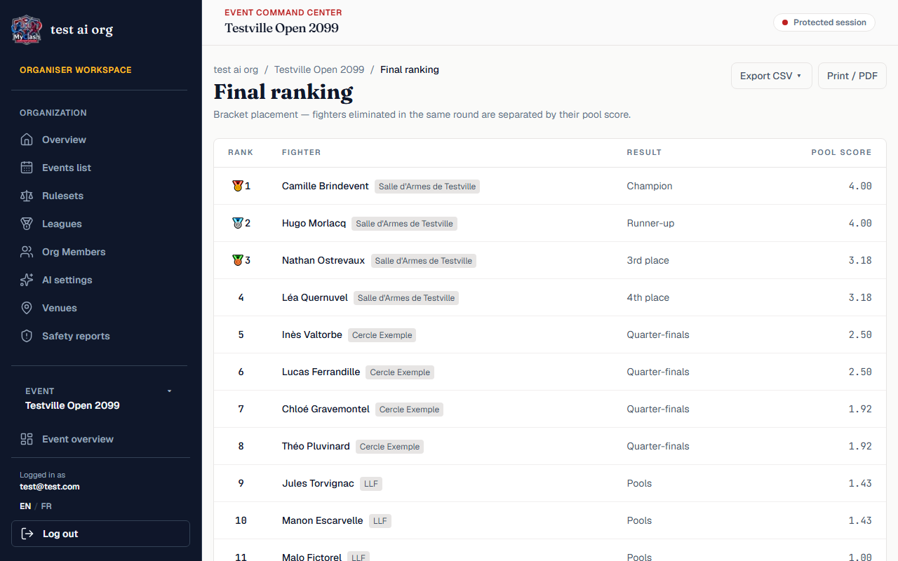

**Ce que vous allez faire :** vérifier le classement final, rendre votre événement et ses
résultats publics, et les envoyer à HEMA Ratings.

## Le classement final

Sur votre événement, ouvrez **Classement final**. Les combattants sont classés selon le tour
atteint dans le tableau ; ceux éliminés au même tour sont départagés par leur score de poule.
**Exporter CSV** le télécharge, et **Imprimer / PDF** l'imprime.

## Le rendre public

Deux interrupteurs, il faut les deux :

1. **L'événement.** Sur **Vue événement**, la carte **Visibilité de l'événement** porte
   l'interrupteur : **Publier** publie l'événement, **Repasser brouillon** le retire. Si quelque
   chose n'est pas encore prêt, MyClash demande d'abord et propose **Publier quand même**.
2. **Chaque tournoi.** Sur la même page, chaque tournoi a sa pastille : **Brouillon** ou
   **Publié**. Un tournoi démarre en brouillon.

Le public ne voit les poules, le tableau et les résultats d'un tournoi que si l'événement et le
tournoi sont publics tous les deux. Un événement de test n'est jamais public.

## HEMA Ratings

Ouvrez **HEMA Ratings**, cliquez sur **Télécharger le dossier de soumission**, décompressez-le, et
envoyez-le par le portail de soumission de HEMA Ratings (la page donne le lien). Seul un
événement **Standard** le peut : un événement de test ou de club affiche un message expliquant
que ses résultats ne comptent pas pour le classement.

<aside class="guide-warn">
  
<strong>Difficile à annuler.</strong> La première fois que vous publiez un événement Standard,
  MyClash prévient les abonnés de votre organisation. Le repasser en brouillon ne retire pas ce
  message. Passer un tournoi public en « terminé » prévient aussi ses combattants.

</aside>
