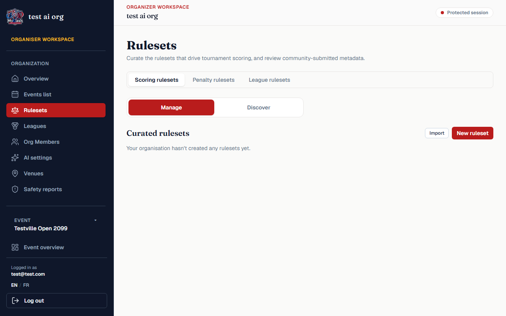
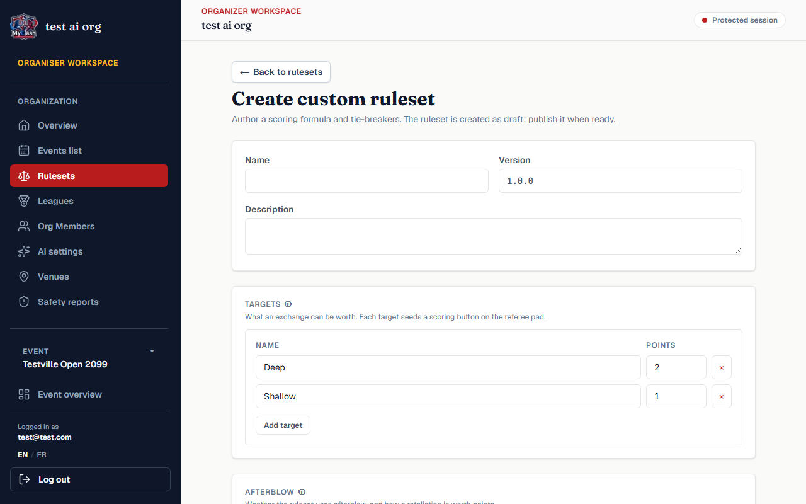

**Ce que vous allez apprendre :** ce que décide un règlement, ceux que MyClash fournit, et comment
créer vos propres règlements de score et de pénalités.

Un tournoi a deux règlements :

- un **règlement de score** : ce que vaut chaque touche, comment se classe une poule, et les
  boutons qu'affiche la tablette de score ;
- un **règlement de pénalités** : la liste des pénalités que propose la tablette, et le carton que
  vaut chaque récidive.

Ouvrez **Rulesets** dans le menu de votre organisation pour les voir tous.

## Les règlements de score intégrés

- **TF_v1** : une touche profonde vaut 2, une touche superficielle 1. Le score de poule, ce sont
  les victoires (3 chacune) plus les points marqués, divisés par les touches reçues plus une
  pénalité qui grandit avec les doubles. Les poules se classent selon ce score, puis les
  victoires, puis le moins de doubles, puis le moins de touches reçues.
- **Points Cap (Premier à N points)** : le premier qui atteint la limite de points gagne. Une seule
  cible, qui vaut 1. Les poules se classent selon les victoires, puis la différence de points,
  puis les points marqués.

## Créer votre règlement de score

Il faut le rôle **Administrateur** (ou **Propriétaire**) dans votre organisation.

1. Sur **Rulesets**, cliquez sur **Nouveau ruleset**, ou sur **Cloner** à côté d'un règlement dont
   vous voulez partir.
2. Remplissez le formulaire :
   - **Nom**, **Version** et **Description**.
   - **Cibles** : ce que peut valoir un échange. Chaque cible devient un bouton de score sur la
     tablette. Ajoutez-en avec **Ajouter une cible**.
   - **Contre-frappe** : cochez **Ce règlement utilise la contre-frappe**, puis choisissez la
     **Valeur de la riposte** (**Valeur fixe** ou **Valeur de la cible touchée**) et le
     **Mode de contre-frappe par défaut** (**Complet** ou **Déductif**).
   - **Constantes** et **Pénalité de double touche** : les valeurs qu'utilise la formule.
   - **Formule de score** : comment se calcule le score de poule d'un combattant. Vous la
     construisez avec des nombres, les résultats du combattant (victoires, nuls, défaites,
     doubles, touches données, touches reçues) et les quatre opérations. MyClash la vérifie ; il
     n'exécute jamais de code saisi dans un formulaire.
   - **Tie-breakers** : l'ordre qui départage des combattants à égalité de score.
3. Enregistrez. Le règlement est utilisable tout de suite dans vos tournois.

_Les versions._ Dès qu'un tournoi utilise une version de votre règlement, cette version ne se
modifie plus : changez la **Version** et enregistrez-en une nouvelle.

_Le partage._ **Soumettre pour revue** demande à l'équipe MyClash de partager votre règlement
avec les autres organisations. La revue ne décide que du partage : vos propres tournois peuvent
utiliser le règlement avant, pendant et après.

## Les règlements de pénalités

Celui intégré est **Penalty - Tournois fédéraux FFAMHE** : 28 pénalités en 5 groupes, comptées par
combat. Un carton jaune ne coûte rien, un carton rouge coûte un point, et un carton noir fait perdre
le combat ; un second carton noir sort le combattant du tournoi. Dans un groupe, chaque récidive
vaut le carton suivant de la liste, et le dernier carton se répète.

Pour créer le vôtre : sur **Rulesets**, ouvrez les règlements de pénalités et cliquez sur
**Nouveau ruleset de pénalités**. Réglez le **Code**, la **Portée d'accumulation**, s'il est
**Visible aux autres organisations**, les **Coûts des cartons & portée du forfait**, puis les
**Entrées** : **Ajouter un groupe**, puis **Ajouter une entrée** pour chaque pénalité, avec ses
cartons dans l'ordre où ils montent.

Dès qu'un tournoi utilise un règlement de pénalités, il est figé : clonez-le pour le modifier.

## Les réclamations

Dans les paramètres d'un tournoi, onglet **Affichage**, **Limite de réclamations** limite les
réclamations par combattant et par combat (vide = pas de limite).
**Pénalité proposée au-delà de la limite** choisit la pénalité que propose la tablette quand un
combattant réclame encore une fois.

<aside class="guide-warn">
  
<strong>Difficile à annuler.</strong> Dès qu'un combat d'un tournoi a commencé, son règlement
  est verrouillé. Seul le propriétaire de l'organisation peut le changer, avec
  <strong>Modifier le règlement</strong> et une raison publique.

</aside>
