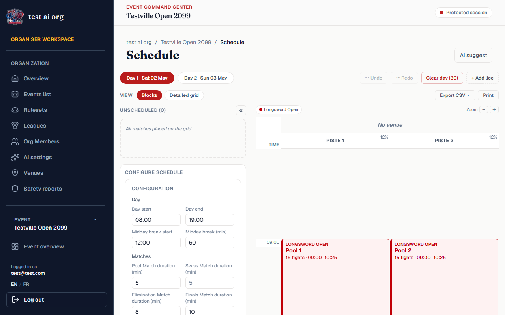

**Ce que vous allez faire :** décider quand et sur quelle lice chaque combat a lieu.

## Régler la journée

Sur votre événement, ouvrez **Planning**. Dans le panneau **Configurer le programme**,
remplissez :

- **Début de journée** et **Fin de journée** ;
- la durée d'un combat en minutes, pour les poules, les rondes suisses, l'élimination et les
  finales ;
- **Début de pause déjeuner** et **Pause déjeuner (min)**.

Chaque jour de l'événement a son onglet en haut (Jour 1, Jour 2…).

## Placer les combats

1. **Générer le programme** propose des blocs horaires pour chaque phase de tournoi, sur vos
   lices.
2. **Générer la grille** place chaque combat de ces blocs sur une lice, à une heure. Il demande
   d'abord : les combats déjà placés sont remplacés.
3. Ajustez à la main : faites glisser un groupe des combats non planifiés sur une case, ou
   déplacez un combat sur la grille. **Grille détaillée** montre chaque combat ; **Blocs** montre
   la vue d'ensemble.
4. **+ Ajouter une lice** ajoute une lice s'il vous en manque une.

**Annuler** et **Rétablir** reviennent sur les derniers déplacements d'un combat, mais pas sur
tout : vider un jour, déposer un groupe ou déplacer un bloc entier ne s'annule pas ainsi.

<aside class="guide-warn">
  
<strong>Difficile à annuler.</strong> <strong>Vider le jour</strong> vide toute une journée,
  et <strong>Générer la grille</strong> remplace les combats déjà placés. Ni l'un ni l'autre ne
  s'annule avec <strong>Annuler</strong>.

</aside>
