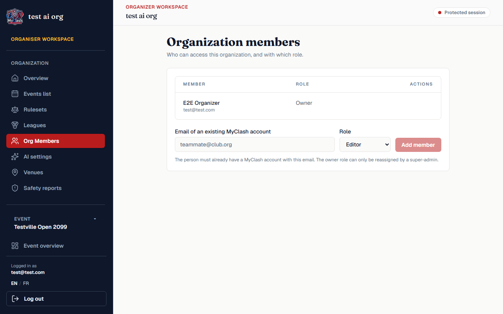
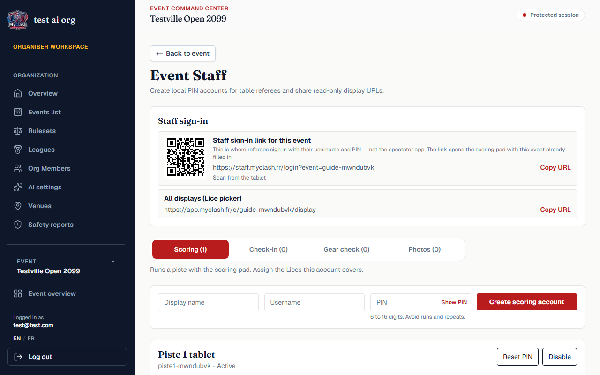

**Ce que vous allez apprendre :** les deux sortes d'accès de MyClash, les membres de
l'organisation et les comptes des tablettes, et la place des arbitres.

## Les membres de l'organisation

Un membre se connecte avec son propre compte MyClash et travaille dans l'espace organisateur. Son
**rôle** décide de ce qu'il peut faire. Chaque rôle peut tout ce que peuvent les rôles en dessous
de lui.

| Rôle                         | Ce qu'il ajoute                                                                                                                  |
| ---------------------------- | -------------------------------------------------------------------------------------------------------------------------------- |
| **Propriétaire**             | Les réglages de l'organisation ; ajouter et retirer des membres ; changer un règlement verrouillé                                |
| **Administrateur**           | Les règlements de score et de pénalités ; la liste des membres ; le logo                                                         |
| **Éditeur**                  | Faire tourner les événements : lices, poules, tableaux, planning, arbitres, comptes des tablettes ; rouvrir un combat verrouillé |
| **Instructeur**, **Arbitre** | Leurs ateliers et leurs arbitrages                                                                                               |
| **Teneur de score**          | Marquer les combats sur la tablette avec son propre compte, sur n'importe quelle lice, sans PIN ; la salle de contrôle en direct |
| **Lecture seule**            | Voir les événements de l'organisation, brouillons compris                                                                        |

Pour ajouter un membre, ouvrez **Membres de l'organisation**. Saisissez
l'**Email d'un compte MyClash existant**, choisissez le **Rôle**, et cliquez sur
**Ajouter un membre**. Seul le propriétaire peut ajouter ou **Retirer** des membres. La personne
doit déjà avoir un compte MyClash. Le propriétaire ne peut pas être retiré, et seule l'équipe
MyClash peut donner le rôle de propriétaire à quelqu'un d'autre.

## Les comptes des tablettes

Un compte de tablette appartient à un seul événement. Il n'a pas d'e-mail : un bénévole se connecte
avec un identifiant et un PIN. Créez-les sur la page **Staff événement** de l'événement (il faut le
rôle **Éditeur**).

| Type                     | Ce qu'ouvre la tablette                                                |
| ------------------------ | ---------------------------------------------------------------------- |
| **Scoring**              | La liste de ses lices, puis la tablette de score                       |
| **Accueil**              | L'accueil des participants                                             |
| **Contrôle du matériel** | Le contrôle de l'équipement                                            |
| **Photos**               | La modération des photos envoyées (jusqu'à l'archivage de l'événement) |

- **Identifiant** : de 3 à 64 caractères, lettres, chiffres, points, tirets et tirets bas.
- **PIN** : de 6 à 16 chiffres. Les suites, les répétitions et les codes courants sont refusés.
- Un compte de scoring ne marque que les lices de ses **Affectations de lice**.
- Le lien **Connexion staff** (et son QR code) ouvre la connexion avec votre événement déjà
  rempli. Chaque compte a aussi son propre lien qui remplit l'identifiant : le bénévole ne saisit
  que le PIN.
- **Désactiver** arrête un compte tout de suite ; **Activer** le remet en service ;
  **Réinitialiser PIN** lui donne un nouveau PIN. Un compte ne se supprime pas.

## Les arbitres

Un arbitre n'est pas un compte. C'est une personne de votre événement que vous ajoutez sur la page
**Arbitres**, avec ses qualifications. Si cette personne a un compte MyClash lié à son profil de
combattant, elle voit aussi ses arbitrages dans son espace personnel.
