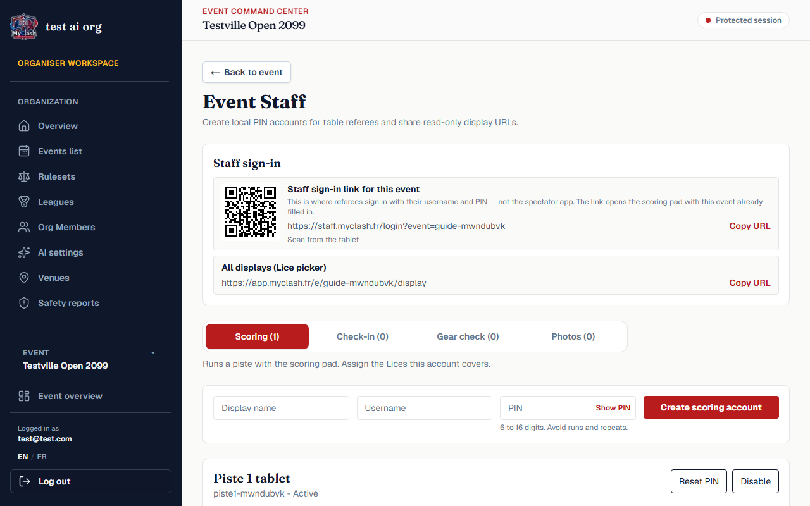
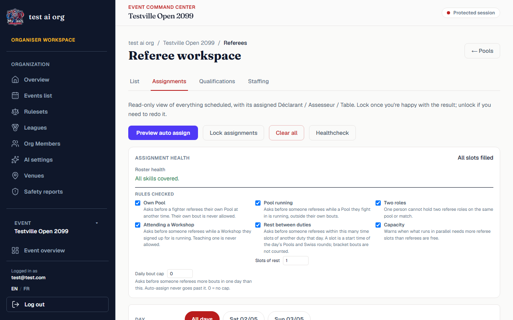

**Ce que vous allez faire :** donner un compte à chaque tablette de score, ajouter vos arbitres,
et laisser MyClash les affecter.

## Les tablettes de score

Sur votre événement, ouvrez **Staff événement**.

1. L'encadré **Connexion staff** contient le lien de connexion de vos tablettes, avec un QR code
   à scanner depuis la tablette. Le lien ouvre la tablette de score avec votre événement déjà
   rempli.
2. Dans l'onglet **Scoring**, remplissez le nom affiché (par exemple « Tablette lice 1 »),
   l'identifiant et le **PIN**, puis cliquez sur **Créer un compte de scoring**. Le PIN compte de
   6 à 16 chiffres ; MyClash refuse les codes faciles comme 123456 ou 111111.
3. Sous **Affectations de lice**, donnez au compte les lices qu'il marque. Un compte ne marque
   que les lices qui lui sont affectées.

Les autres onglets (**Accueil**, **Contrôle du matériel**, **Photos**) créent des comptes pour
votre accueil, votre contrôle du matériel et la modération des photos.

Un compte ne se supprime pas, il se désactive. L'identifiant d'un compte désactivé ne peut pas
être réutilisé.

## Les arbitres

Ouvrez **Arbitres**. L'**Espace arbitres** a quatre onglets : **Liste**, **Affectations**,
**Qualifications** et **Effectif**.

1. **Liste** : cherchez une personne de votre événement dans **Ajouter un arbitre**, et cliquez
   sur **+ Ajouter**.
2. **Qualifications** : indiquez ce que chaque arbitre sait faire : déclarant, assesseur ou
   table. Il faut pour cela un profil global ; liez-en un d'abord si MyClash le demande.
3. **Affectations** : cliquez sur **Lancer le calcul**. MyClash propose un arbitre pour chaque
   rôle de chaque poule. Vérifiez, puis cliquez sur **Appliquer le calcul**. Quand tout vous
   convient, cliquez sur **Verrouiller les affectations**.

## Les règles que MyClash vérifie

Certaines règles n'ont pas d'interrupteur : personne n'arbitre son propre combat, personne
n'arbitre en même temps qu'il combat, qu'il arbitre ailleurs ou qu'il anime un atelier, et
personne n'arbitre en dehors des disponibilités qu'il a déclarées.

Les autres sont des vérifications que vous pouvez désactiver sous **Règles vérifiées** :
**Sa poule** (arbitrer une poule où l'on combat, à un autre moment), **Poule en cours** (arbitrer
pendant que sa propre poule tourne ailleurs), **Deux rôles**, **Participation à un atelier**,
**Repos entre arbitrages** et **Capacité**, plus un **Plafond quotidien de combats** (0 = aucune
limite).

<aside class="guide-warn">
  
<strong>Difficile à annuler.</strong> <strong>Tout effacer</strong> supprime toutes les
  affectations. Tant que les affectations sont verrouillées, le calcul automatique et
  <strong>Tout effacer</strong> sont désactivés : cliquez d'abord sur
  <strong>Déverrouiller les affectations</strong>.

</aside>
