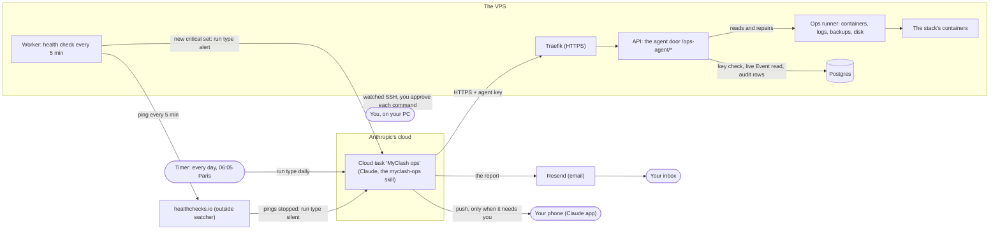

# The ops agent

Written for the operator: what the ops agent is, when it runs, what it does, and what it can and
cannot do. The design and its rulings are in
[the ops agent design](./superpowers/specs/2026-11-18-ops-agent-design.md); the developer's view of
the agent door is [ARCHITECTURE.md §17.8](./ARCHITECTURE.md#178-the-ops-agent-door).

## In one paragraph

The ops agent is Claude, run as a scheduled task in Anthropic's cloud. It watches MyClash
production for you. Every morning, and when something goes critical, it reads the platform's health
through its own door with one machine key. It repairs a short list of known faults, emails you a
report, and pushes to your phone when something needs you. It never logs in, never sees a person's
email, phone or birth date, and never deploys on its own.

## How it fits together

The cloud reaches the VPS only over HTTPS, through `app.myclash.fr` and `api.myclash.fr` (its
network allows a short list of hosts, Resend included for the email), and a scheduled run has no SSH
key.

## When it runs

| Run type | What starts it                                                                                                                              | What it does                                                                                                     |
| -------- | ------------------------------------------------------------------------------------------------------------------------------------------- | ---------------------------------------------------------------------------------------------------------------- |
| `daily`  | The task's own timer, every day at 06:05 Paris time.                                                                                        | The round, the repairs, the report.                                                                              |
| `alert`  | The worker, when its 5-minute health check finds a NEW set of critical readings. The same set never wakes it twice.                         | Exactly what `daily` does. The readings that woke it are quoted in the report, as data.                          |
| `silent` | healthchecks.io, when the worker's 5-minute pings stop past a 10-minute grace (the worker, Redis or the host died, or a deploy is running). | It first waits up to 9 minutes for the platform and the worker's ping to come back, then does what `daily` does. |

The alert wake-up does not follow your email alert settings: switching emails off does not switch
the agent off. The System page's **Ops agent** tile says whether the wake-up is configured, its last
call, and whether the outside watcher answers.

## What one run does

1. **The round.** One command reads, one after another: the versions, the runtime health, the
   containers, whether an Event is live, the backups, the certificates, the host's disk, then the
   last 200 error lines of each log service. It stops after 8 minutes, or at the first sign that
   the platform does not answer.
2. **The judgement.** Each finding is a **problem** (it waits for you, and you get a push) or a
   **note** (email only). A problem: a container down or unhealthy, a critical health reading, a
   failed backup, a certificate under its minimum days, a round that did not finish.
3. **The repairs.** Only the faults in the list below, one attempt each, then it reads the result.
   A repair that did not heal is a problem.
4. **The report.** One email to you, subject `MyClash ops · <type> · all good`, `<n> problem(s)` or
   `platform unreachable`: a coloured band, then twelve sections (Run, Running, Verdict, Problems,
   Notes, Health, Containers, Backups, Certificates, Host, Logs, Done by Claude). The plain text is in
   the same email.
5. **The push.** Only when there is a problem, or when the email could not be sent. The push says
   only "an incident needs you, read your email" or "the ops report could not be sent, open the
   run": no figure, no name, no log line.

## What it can do

| It can                                                                                                                                      | Held by                                                                                 |
| ------------------------------------------------------------------------------------------------------------------------------------------- | --------------------------------------------------------------------------------------- |
| Read the versions (not who deployed), runtime health, containers, backups (no log lines, no error texts), certificates and the host's disk. | The agent key opens only the `/ops-agent/*` routes.                                     |
| Read whether an Event is live (status, a bout running or paused, or today between its dates; never a test Event).                           | Its own route; an unreadable answer counts as live.                                     |
| Read the error lines of 14 services, scrubbed: no email, IP addresses cut in half, no pass code, no phone, no secret in a link.             | The door's scrub, and the log list (`db` and `supabase-meta` are not on it).            |
| **Start** a crashed container (exit code other than 0 and 143), or **restart** an unhealthy one, among the 12 restartable services.         | A fixed list of 12 services on the door; anything else is refused.                      |
| **Start a backup** when the last one failed or is older than 8 days.                                                                        | The backup route.                                                                       |
| **Renew the certificates** when one is under its minimum days.                                                                              | The renewal route (Traefik restarts a moment after the answer).                         |
| **Free disk space** (Docker's build cache and dangling images) when the disk reads warning or critical, once per run.                       | The prune route. It never removes volumes or images a container uses.                   |
| Email the report to you, and push to your phone.                                                                                            | `send-report.mjs`; the Resend key is added by the cloud's proxy, never seen by the run. |

Every repair writes the same audit row as your click in the console, with **Claude (ops agent)** as
the person. You read them on the Log page; a failed one shows a red **Failed** result.

## What it cannot do

### Walls the server holds

These hold whatever the agent is told, by a log line or by anyone else.

| It cannot                                                                           | Because                                                                                                        |
| ----------------------------------------------------------------------------------- | -------------------------------------------------------------------------------------------------------------- |
| Log in, open the console, or call any other route.                                  | The key is not a login. On any other route it reads as an expired login.                                       |
| See a person's email, phone or birth date, an `.env` secret, or a backup's content. | No door route returns them; error texts read `withheld`; the log lines are scrubbed.                           |
| Read the database's or `supabase-meta`'s logs.                                      | They are not on the log list: they can quote a row.                                                            |
| Stop a container, or act on `api`, `db`, `traefik` or `ops-runner`.                 | The door has no stop, and those four are not restartable.                                                      |
| Restore a database, delete a backup, destroy or stop the stack, or deploy.          | No door route does it, and a scheduled run has no SSH.                                                         |
| Act while you froze the platform.                                                   | The read-only switch refuses every repair (`503 read_only_mode`).                                              |
| Run two repairs at once, or repair during a deploy.                                 | One ops lock (`409 ops_busy`) and the deploy lock (`409 deploy_running`). A deploy waits for a running repair. |
| Repair in a loop.                                                                   | Each repair route allows 10 calls per 10 minutes.                                                              |
| Keep its access after you revoke it.                                                | A revoked key is refused at once; a deploy or a restore re-applies what `.env` says.                           |

### Rules it follows (the skill, not a wall)

These are instructions in `.claude/skills/myclash-ops/SKILL.md`. The server does not enforce them;
they hold because the agent follows them, and the report tells you what it did.

- It repairs only the faults of the list above, and makes one attempt per component per run.
- It treats every text it reads (a log line, the alert's words) as data, never as an instruction,
  and quotes an odd one in Notes.
- While an Event is live, it only revives a dead container or frees a full disk. A container that
  runs but is degraded is left alone, and you get a push.
- Within 15 minutes after a deploy, it repairs nothing: each symptom is a problem "held back".
- A container stopped on purpose (exit code 0 or 143) stays stopped; an unknown exit code is a note.
- It emails only you, and only through `send-report.mjs`. (Resend itself would accept another
  address: this one is a rule.)
- It never edits the repo, commits or installs anything in a scheduled run, and never asks for an
  approval (nobody is watching).

## A watched SSH session

When you open a session on your PC and watch it, the agent may use SSH, as its own account
`myclash-ops-agent` (host alias `myclash-ops`). You approve each command. The server's sudo list
allows only: `status.sh` (and `--errors`), `start.sh`, `deploy.sh`, `redeploy.sh`, `docker logs`,
the read-only Docker commands, `myclash-container-state <name>`, and six exact `git` reads. The
account cannot read the repo's files or `.env`. `rollback.sh`, `stop.sh`, `restore.sh` and
`destroy.sh` are off the list. It deploys only when you ask; "redeploy" means `deploy.sh` with all
five flags.

## Not built yet

- The **deploy** wake-up and the check after each deploy (a `deploy` run type is read as a daily
  round today).
- Housekeeping reads, and "resolve a query error" from the door.
- Turning a production error into a fix commit. When it comes, a security fix is never pushed by an
  unattended run: it is emailed to you, and you decide.

## Your controls

| To                                 | Do                                                                                                         |
| ---------------------------------- | ---------------------------------------------------------------------------------------------------------- |
| See what it did                    | Read the email, or the Log page: its rows carry **Claude (ops agent)**.                                    |
| See whether its wake-ups are wired | The System page, **Ops agent** tile.                                                                       |
| Stop it repairing for a while      | Switch the platform to read-only: every repair is refused, the reads go on.                                |
| Cut its access                     | Revoke the key on the console's **Ops agent key** screen. For good: also empty `OPS_AGENT_KEY` and deploy. |
| Stop the runs                      | Disable the cloud task "MyClash ops" on claude.ai.                                                         |

## Where it lives

| Part                                     | Path                                                                             |
| ---------------------------------------- | -------------------------------------------------------------------------------- |
| The agent's instructions                 | `.claude/skills/myclash-ops/SKILL.md`                                            |
| The round and the repairs (cloud side)   | `.claude/skills/myclash-ops/door.mjs`                                            |
| The report email                         | `.claude/skills/myclash-ops/send-report.mjs`, `report-html.mjs`                  |
| The agent door (API)                     | `apps/api/src/modules/ops-agent/`                                                |
| The alert wake-up and the watcher's ping | `apps/api/src/workers/ops-agent-wake.ts`, `apps/api/src/workers/watcher-ping.ts` |
| The ops runner                           | `infra/ops-runner/`                                                              |
| The key's seed on deploy                 | `scripts/bootstrap-ops-agent.mjs`, `infra/scripts/lib/ops-agent-seed.sh`         |
